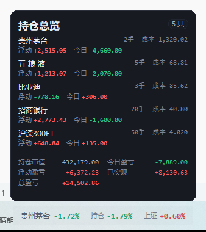

# 更新日志 (Changelog)

> 股票智能选股悬浮窗 StockPick 的版本更新记录。
> 当前版本 **v2.0.1** · 查看全部历史版本：[Releases](https://github.com/gdy4803-maker/stock-bar/releases)

---

## v2.0.1 更新（海外股票 / ETF 数据修复）

### 修复
- **海外代码统一**：搜索支持 A股、港股、美股和 ETF；`QQQ`、`AAPL`、`BRK.B` 等无前缀代码自动补 `us`。
- 腾讯搜索返回的 `usqqq.oq`、`usspy.am`、`usbrk.b.n` 会去掉交易所后缀，统一成 `usQQQ`、`usSPY`、`usBRK.B`，加入自选后行情接口能正常取数。
- **美股 K 线**：行情代码不带交易所后缀，K 线接口却需要后缀；现自动按 `.OQ/.N/.AM` 匹配并缓存（QQQ=.OQ、SPY=.AM、BRK.B=.N），不再只显示一根 K 线。
- 详细窗口搜索不再过滤港股/美股，QQQ 等搜索结果可直接打开或加入自选；管理自选股搜索同步支持海外标的。
- 海外股票/ETF 的实时价、涨跌幅、成交量/额均按腾讯行情显示；美股休市时分时只显示最新价，可切日/周/月 K 看历史。

---

## v2.0.0 更新（品牌升级 + 标签内 AI 选股）

### 品牌
- 产品名由「看股插件」升级为 **股票智能选股悬浮窗**，英文名 **StockPick**。
- 定位统一为「基于 AI 大模型的选股悬浮窗」：行情、板块成分、标签内选股与 AI 研判在一条悬浮条上完成。
- 窗口标题、程序版本、帮助、README、构建产物与发布包同步改名；新增 `STOCKPICK_LLM_KEY` 环境变量，兼容旧 `STOCKBAR_LLM_KEY`。

### 新增：标签内选股
- **成分行 + 加自选**：标签成分窗口左栏每只股票右侧显示 `+`，点击直接加入自选；已在自选显示 `✓`。
- **AI 选股**：标签窗口顶部手动点「AI 选股」，先按涨幅/成交额/换手/量比做规则初筛（24 只候选），
  再交给大模型按编号复核，输出 3–6 只观察候选及理由；模型只能选已有编号，不能新增股票或自由报价。
- 选股结果按 AI/规则排名显示在左栏，点「全部」恢复该标签全部 A 股；每条结果仍可点 `+` 加自选、点股票切右侧图表。
- 未配置 AI Key 时自动退化为规则初筛并明确提示，不会阻塞标签浏览。

### 保留 1.9.0
- 独立标签成分窗口、手动 AI 研判、所有窗口不透明度设置继续保留。

## v1.9.0 更新（标签成分窗口 + 手动研判 + 窗口透明度）

### 新增
- **标签成分窗口**：详细窗口的行业/地域/概念标签 chip 可点击，打开独立单例窗口。
  - 左栏列出该标签下全部 A 股（过滤 B 股），按涨跌幅降序；大板块虚拟滚动，顶部搜索只过滤当前标签成分。
  - 右栏沿用详细窗口：分时/K线、周期/指标、五档逐笔、板块标签、狙击点位与 AI 研判。
  - 标签窗口与详细窗口各自记忆几何、置顶、左栏宽度；不覆盖原详细窗口布局。
  - 成分接口分页拉取、缓存 30 分钟；失败 60 秒后可重试。
- **所有弹窗窗口不透明度**：设置 → 外观新增「窗口不透明度」40%–100%，
  实时作用于设置、帮助、详细、标签成分、持仓、管理等 BaseDialog 窗口；行情条仍用文字/背景透明度，
  悬停卡仍用卡片透明度。
- **AI 研判改为手动触发**：详细窗口和标签成分窗口滚动到 AI 不再自动请求；
  只有点右上角「重新研判」或下方「立即研判」才调用模型。竞价卡 9:25 自动研判保持独立设置。

### 修复
- 保留 1.8.1 的详细窗口配色跟随与港股/美股涨跌幅解析修复。
- 标签成分接口对东财短时风控增加顺序翻页、单页重试和失败短缓存，避免大板块触发限流后长时间空白。

## v1.8.1 更新（Bug 修复）

### 修复
- **详细窗口涨跌颜色不跟随设置**：切换「红涨绿跌 / 绿涨红跌」后，详细分时/K 线窗口会同步重新读取
  palette 并重绘；主题切换时详细窗口也会自动重建，不再沿用打开窗口时的旧配色。
- **港股、美股涨跌幅恒为 0%**：行情时间解析兼容腾讯港美股的
  `YYYY/MM/DD HH:MM:SS` 与 `YYYY-MM-DD HH:MM:SS` 格式；港美股按行情源涨幅显示，
  A 股开盘前的昨日行情仍按 0% 处理，避免今日盈亏口径错乱。

## v1.8.0 更新（板块标签 + 狙击点位）

### 新增
- **板块 / 概念标签**：详细窗口图表下方新增标签行。东方财富个股所属板块接口，按
  「行业 → 地域 → 概念」排序，默认展示行业最多 2 个、地域 1 个、概念 6 个，其余显示总数；
  带当日板块涨幅，过滤沪深300/上证50/融资融券/基金重仓/大盘小盘等指数与风格标签。
  按股票代码缓存 30 分钟，失败静默降级，不阻塞行情。
- **狙击点位**：详细窗口标签下方新增 5 行表：理想买入、二次买入、止损、止盈1、止盈2，
  附依据、状态、风报比和日线数据脚注。
  - **程序先算候选**：180 根前复权日线；MA5/10/20/60、近 20/60 日摆动高低点、前平台高点、
    0.382/0.5/0.618 回撤、ATR14、1.618 扩展。
  - 理想买入 = 现价下方最近支撑簇；二次买入 = 理想区下方下一档支撑（没有合适下一档时显示“—”，
    不硬凑）；止损 = 二次支撑下方 0.3/0.5 ATR，并参考 MA60/近低点与 6% 最大风险位；
    止盈 = 上方结构压力，无压力时用 ATR 扩展。
  - **AI 只选编号，不报价**：Prompt 给出 I1/S1/L1/T1 等候选，模型只能返回编号；
    程序复核顺序、编号存在性与风报比（默认要求 ≥1.5）；不合法时回退规则默认，
    右上角显示「规则候选 / AI 选择 / 规则回退」。
  - 点位状态随 2 秒行情刷新：等待回踩、已进入区间、距止损、距止盈、计划失效。
  - 指数模式自动隐藏板块/点位；普通个股恢复显示。

### 兼容与回归
- 保留 1.7.1 的规则评分修复、1.7.0 左栏搜索/整页滚动/AI 分模块，以及 1.6.0 全部分时/K线/盘口交互。
- 详细窗口默认 1280×800、最小 1120×680；深色/浅色、置顶、单例切股不变。

## v1.7.1 更新（规则评分修复）

### 修复
- **规则评分总分始终等于五项得分之和**：修复训练权重覆盖总分后，明细相加与“规则评分”不一致的问题
  （例如五项 `2+2+0-1-1` 仍应显示 `+2`，不再被模型压成 `-1`）。
- **劣化权重不再启用**：训练结果准确率不高于启发式基线时只写日志、不覆盖 `weights.json`；
  启动时也会忽略“模型准确率 ≤ 基线”的旧权重，继续使用透明的五项规则评分。
- 训练权重仍保留在 `auction_data\weights.json` 供复盘/参考，但只作为 `model_total/model_prob` 辅助字段，
  不改变界面上的规则总分和结论。

## v1.7.0 更新（自选左栏 + 整页 AI 研判）

### 新增
- **详细窗口左侧全高自选栏**：顶部搜索框（代码/名称/拼音），下方自选列表独立滚动；
  搜索结果可直接切股，`+` 加入自选，已存在显示 `✓`；搜索只保留沪深京 A 股，过滤同名港美股噪声。
- **左/右可拖动分隔线**：左栏宽度可调（默认约 220，范围约 180–360），双击恢复默认；
  宽度写入 `detail_left_width`，下次打开沿用。左栏占满窗口高度，与右侧图表彻底分开。
- **右侧整页纵向滚动**：顺序为「图表 + 五档/逐笔（严格等高） → 周期/指标 → AI 研判」；
  图表、盘口、周期/指标、AI 都在同一页，滚轮下翻到 AI。左侧自选、图表缩放、逐笔翻页各自保留原滚轮行为。
  - 中立区域（右侧滚动条/空白、周期行、AI 区域）滚轮滚整页；
  - 图表内滚轮仍是缩放，五档/逐笔内滚轮仍是逐笔翻页，左栏内滚轮仍是自选列表；
  - `AI ↓` 一键滚到 AI，AI 标题旁 `↑ 回到图表` 回到顶部。
- **AI 研判（详细窗口内分模块）**：01 评分（0–100 + 评分区间）、02 推荐（动作 + 结论）、
  03 建议/理由、04 风险、05 观察计划（触发/失效/下次检查）、06 数据质量 + 免责声明。
  - 本地时钟分阶段：盘前 / 竞价 / 撮合 / 开盘 / 早盘 / 午间 / 盘中 / 尾盘 / 盘后 / 休市；
  - 评分/动作口径：80–100 强烈买入、60–79 买入、40–59 观望、20–39 减仓、0–19 卖出；
    动作支持买入/加仓/持有/减仓/卖出/观望/回避/预警；
  - 评分与动作冲突时显示「口径待复核」，不静默吞掉；
  - 数据质量由程序本地计算（行情延迟/非今日、分时/竞价日期、基本面摘要缺失、五档/逐笔缺失、
    指数无盘口等），不交给模型编造；
  - 首次滚入 AI 区域且当前阶段无缓存时自动研判；按代码+日期+阶段缓存，支持“重新研判”；
  - 未启用或未填 API Key 时显示设置入口，不请求接口。
- **详细窗口尺寸**：默认 1280×800，最小 1120×680；旧版保存的较小几何会自动夹到新下限。

### 兼容与回归
- 保留 1.6.0 全部分时/5日/日K/周K/月K、量/MACD/KDJ、五档/逐笔、十字光标、缩放平移、
  双击复位、点盘口画线、指数隐藏右栏、置顶、深色/浅色主题与单例切股。
- 行情 2 秒、分时 30 秒、逐笔 2 秒、K线 60 秒刷新节奏不变；窗口不可见时继续暂停。

## v1.6.0 更新（股票详细大窗口）

### 新增
- **股票详细大窗口**：在详情卡的分时图上左键单击，或按 `Enter`，打开同花顺/东方财富式大窗口；
  持仓总览卡整卡单击进入「持仓设置」，指数分时图单击进入指数详细窗口。
- **分时图**：价格线（按涨跌着色）、均价线、昨收虚线、成交量柱、上下端点价格、左右百分比轴；
  支持十字光标、滚轮缩放（30–240 分钟）、拖动平移、双击复位、单击锁定光标。
  现价点、时间轴 09:30–15:00 完整显示，左右端点标签不裁切。
- **5日分时**：按日本地累积，逐日补到 5 天；历史不足时明确提示“当前 N/5 日”，不拿日K冒充。
- **K线**：日K / 周K / 月K，MA5/10/20 图例与颜色对应；成交量、MACD、KDJ 可切换；
  MACD 的 DIF/DEA、KDJ 的 K/D/J 均有颜色图例；日期轴按周期显示 MM-DD 或 YYYY-MM，末根日期固定标注。
- **右侧面板**：五档盘口 + 成交明细；点五档价格在主图画黄色价位线；逐笔滚轮翻页、
  到最早一页自动加载更早数据。指数模式自动隐藏右栏，图表占满窗口。
- **交互**：单例窗口复用、切股、位置/大小记忆、置顶开关、深浅主题、Esc 关闭；
  行情 2 秒、分时 30 秒、逐笔 2 秒、K线 60 秒，窗口不可见时暂停。

### 优化
- 详情卡：鼠标在卡片上左右移动不再切换个股/持仓/指数分区，卡片内容保持稳定。
- 详细窗口：头部信息分四列两行排列，指数成交量单位为“股”；指标区与 K 线增加图例；
  月线早期前复权低价不再把纵轴压成负数。
- 使用帮助：新增第 10 节「股票详细大窗口」，快捷键、菜单、数据文件说明同步到 1.6.0，共 12 节。

### 修复
- 详细窗口首次打开偶尔被 Windows 以最小化状态落地（需手动还原）。
- 分时图 `_sub_rects` 返回值解包错误导致窗口反复报 `ValueError`。
- 5日分时只有 1 天时没有时间刻度；多日模式日期标签移到横轴底部。
- K线缩放后最右一根日期不显示、周/月线跨年日期无法区分。
- 指标只按可见区间计算，放大后左侧 MACD/KDJ 起点失真。

## v1.5.5 更新（界面排版修复 + 使用帮助）

### 新增
- **右键菜单「使用帮助…」**（快捷键 `F1`）：打开可滚动图文教程，共 11 节——
  快速开始、行情条操作、右键菜单逐项说明、设置页、管理自选、持仓模拟盘、
  详情卡/竞价评分/AI、收盘选股/强弱排序/异动扫描、更新与配置数据、快捷键、常见问题。
- 原「编辑配置文件」入口移除；帮助窗口底部提供「打开程序目录」，并在教程中说明
  `config.json` 的手动修改方法与数据文件用途。
- **右键菜单精简**：移除「刷新间隔」「复制当前行情」「重新加载配置」三个入口；
  功能不变——刷新间隔仍在设置页，复制行情仍为 `Ctrl+C`，重新加载仍为 `F5`。

### 修复
- **设置页**: “请求时段”“AI 研判”“API Key”提示与快捷键 `Ctrl+Shift+S` 不再被裁切；滑杆数值不再贴住滑块；删除重复/含糊说明
- **详情卡**: 超长股票名自动省略，不挤代码与市场徽标；“分时”与“买一/卖一”统一基线；两列数据间距加大
- **持仓设置**: 交易表单改为 3 列铺满；空成交记录显示“暂无成交记录”；累计买入/卖出去掉多余的“+”
- **收盘选股 / 强弱排序 / 异动扫描**: 空表增加状态占位；精简冗余说明；标点统一
- **支持开发者弹窗**: 底部“关闭”按钮不再被窗口裁掉
- **行情条**: 无持仓时不再显示“持仓 +0.00%”，悬浮分区同步修正

> 数据口径与配置项不变。

## v1.5.4 更新（测试版, 自 v1.5.3）

> ⚠️ **测试版**: 选股/强弱/异动为新功能, 建议先试用反馈后再用于实盘参考。

### 新增
- **收盘选股**（右键菜单）——借鉴 Sequoia-X 的策略思路:
  - **7 个策略可勾选**: 海龟突破 / RPS突破 / 放量突破 / 高窄旗形 / 涨停洗盘 / 跌停反包 / 强势回调
  - 全市场初筛(1 请求) -> 候选深度分析(5~500 只可调) -> **命中策略越多越可靠**
  - 结果列出每条策略的依据; **双击一行加入自选**; 勾选与深度自动记忆
- **自选强弱排序**（右键菜单）——按 **RPS 近似**(60 日跑赢沪深300)与竞价评分排序,
  一眼看出自选里谁最强
- **当日异动扫描**（右键菜单）——全市场筛选涨幅≥4% 且成交额≥2亿, **双击加自选**
- **RPS 相对强度 + 形态提示**进入竞价评分卡与 AI 研判上下文
  (RPS强势/弱势、逼近20日新高、中期趋势)

### 修复
- 新窗口表格样式未跟随主题(深色模式下白色块)
- 窗口按钮被挤出可视区(需拉大窗口) —— 改为按钮栏先占底
- 多次刷新状态文字堆积
- 异动扫描双击加自选失效(配置键错误)

> 分时图/竞价/AI 等原有功能不变; 选股结果仅供参考, 不构成投资建议。
## v1.5.3 更新（自 v1.5.2）

### 优化 · 分时图同花顺化
- **横轴固定 9:30–15:00**（午休压缩; 未到的时间留白, 与同花顺一致）
- **最高点 / 最低点标注**: 圆点 + 价格标签
- **纵轴以昨收为中心对称**, 范围随最高/最低点自适应
- **昨收虚线加强**并标注价格（如 `昨收 1,457.70`）

### 优化 · AI 研判
- **加入技术分析**（MCP full 级别: MACD/KDJ/RSI/布林/OBV/ATR + 信号摘要）
- **独立判断, 不跟随涨跌方向** —— 明确禁止"涨=持有/跌=卖出", 强制引用
  非方向性因素(估值分位/超买超卖/风险收益比), 方向与估值技术矛盾时敢于逆向
- **输出完整显示**（长文本不截断, 卡片自动撑高; token 预算 400→1600, 超时 30→60 秒）

### 优化 · 竞价评分
- **日期兜底**: 当天没有竞价数据时, 显示最近一天的评分并标注日期
  （重启后自动载入最近 3 天存档, 开盘前也能看）
- **规则评分 vs AI 结论并列对照**（不一致时 ⚠ 提示）
- **权重自动训练（模型参考）**: 收盘后自动补"当日涨跌"标签, 启动时用
  纯 Python 逻辑回归自动训练评分权重（无需第三方库）, 存 weights.json 可查/可回退;
  只有验证准确率高于规则基线才启用，且不覆盖界面上的五项规则总分

### 修复
- **设置输入框打字即保存**（停顿 0.6 秒自动落盘, 不必切焦点）
- 行情为空时（收盘后不请求）评分不出 → 用存档昨收兜底
## v1.5.2 更新（自 v1.5.1）

### 新增
- **请求时段设置**（设置 → 行情）：`交易时段 9-16点` / `全天请求` 二选一 ——
  收盘后不再请求接口, 省资源; 周末自动不请求

### 优化
- **设置输入框打字即保存** —— 不用再点别处/切焦点, 停顿 0.6 秒自动保存并落盘
  （覆盖 AI 接口/模型/Key、手续费、指数等全部输入框）
- **竞价数据重启后立即可用** —— 启动时自动载入当日存档, 评分卡/AI 不用等次日采样
- **AI 研判文字自适应卡片高度**（长内容自动撑开, 超 300 字截断, 不再溢出）
- **快捷键 `T`**：悬浮行情条上按 T = 打开竞价评分卡 + 立即 AI 研判（按钮上标注 [T]）
- **鼠标移到卡片上不再自动关闭** —— 卡片上的「AI 研判」按钮可正常点击
- 竞价存档兼容合并（曾迁移到 %LOCALAPPDATA% 的数据自动汇拢, 不丢失）

### 修复
- 打包/升级保护用户数据：`auction_data`、`config.json`、日志、缓存 **永不覆盖**
  （打包脚本"先搬离→替换→放回" + 升级跳过清单双重保障）
## v1.5.1 更新（自 v1.5.0）

### 新增 · AI 研判（大模型）
- **竞价评分卡加「AI 研判」按钮**：按一下调用大模型, 输出 **①综合研判 ②核心理由 ③风险 ④操作倾向**
  + "不构成投资建议"
- **自动研判**：9:25 撮合后对当前显示的股票自动跑一次（每天一次, 设置里可关）
- **服务商可配**：DeepSeek / MIMO / 自定义（OpenAI 兼容接口）；
  Key 支持 **config.json 或环境变量 `STOCKBAR_LLM_KEY`**
- **喂给 AI 的数据（12 类）**：
  竞价撮合价起止/开盘缺口/振幅/量能时序（首末段放量）/买卖余量/撤单痕迹（9:20 前后）、
  开盘后实况（今开/最新/成交额）、**历史统计与基本面**（PE/PB/股息率/ROE + 5/20/60/120/240 日
  均价/振幅/涨跌幅, 来自开源 MCP 数据服务）、大盘竞价、该股近 5 次竞价、规则评分 5 项
- **防幻觉铁律**：只允许引用给定数字, 禁止编造/改写; 输出严格四行格式

### 修复
- **AI 结果串号**：AI 研判结果未绑定股票代码, 切换股票后显示的是上一只的结论 —— 现按股票分开缓存
- **涨幅与金额口径不一致**：今日买入有亏损时, 金额对、涨幅错（涨幅原全按昨收算）；
  现统一为"今日盈亏 ÷ 分批基数"（老仓按昨收、今日买入按买价）
- **升级/打包保护用户数据**：`auction_data\`（竞价存档）、`config.json`、日志、缓存
  **永不覆盖**（升级跳过清单 + 打包脚本双重保障）

### 优化
- **集合竞价存档**：每天 9:25 后自动存 `auction_data\日期.json`（自选+指数+持仓的竞价采样），
  退出兜底保存、同日合并不覆盖 —— 攒够后用于训练评分权重
- 设置 → AI 研判区（单开关「自动研判」+ 服务商/接口/模型/Key）
## v1.5.0 更新（自 v1.3.11）

### 新增
- **东方财富第三源**——腾讯 + 新浪都失效时自动兜底接管（带 3 次退避重试），
  三源容灾，行情不断线
- **集合竞价评分卡**（快捷键 `3`）——集合竞价（9:15–9:25）实时研判：
  - **5 项可解释评分**：高开幅度 / 撮合趋势 / 买卖力量 / 量价配合 / 价格稳定
  - 每项**附依据文字**（不是黑箱结论）+ 结论（偏多：可买入/持有 ｜ 中性：观望 ｜ 偏空：回避/卖出）
  - 竞价图顶部同步显示评分徽章 `[+6 偏多]`（红=偏多、绿=偏空，跟随"涨跌配色"设置）
  - **全天可查**：非竞价时段按 `3` 看当日（或最近一次）评分
  - 右下角标注"评分仅供参考，不构成投资建议"
- **快捷键 `1 / 2 / 3` 切换详情卡**——个股 / 持仓总览 / 竞价评分
  （需鼠标**悬浮在行情条上**才生效；鼠标移开卡片自动关闭）
- **竞价数据静默存盘**——每天 9:25 后自动存 `auction_data\YYYY-MM-DD.json`
  （自选 + 指数 + 持仓的竞价采样，几 KB~几十 KB），用于日后训练评分权重
  （攒 20~30 天后可用回测权重做模型参考；规则总分仍按五项相加，不覆盖明细）

### 修复
- **今日买入亏损时"涨幅"与"金额"显示不一致**——金额按分批口径（老仓算昨收差、
  今日买入算成本差），涨幅却全按昨收算；现改为**同一套基数**（涨幅 = 今日盈亏 ÷ 基数，
  基数：老仓按昨收、今日买入按买价），两种显示口径一致

### 优化
- 设置 → 快捷键区补充 `1/2/3` 说明与使用条件（通俗说明"鼠标要放在行情条上"）
## v1.3.11 更新（自 v1.3.10）

### 新增
- **分时图显示买卖一报价**——`买一 价格×金额` / `卖一 价格×金额`（买一红、卖一绿）；
  金额单位 **亿 / 万** 自动切换、**最多 2 位小数**（如 `1,445.96×101.22万`、`×1.23亿`）
- 集合竞价的「买卖余量」标注同步改为金额格式
- 分时图左右时间标注下移，不再贴着曲线

### 优化（全界面视觉统一）
- **按钮尺寸统一**：高度统一 **32px**（原 28/30/32/34 四种混用），
  宽度四档规范：**主 92 / 次 84 / 宽 104 / 中列 88**
- 修复「删除所选记录」按钮被列表框裁切（改用底栏布局，先占底、列表填充）

### 修复
- **双源合并丢失盘口**——新浪源不带五档，合并时把腾讯的买一/卖一冲成 0；
  现合并缺字段时自动继承
## v1.3.10 更新

### 新增
- **集合竞价视图**（9:15–9:25）——悬停个股显示竞价走势图：
  **虚拟撮合价曲线** + **量柱**（高度 = 虚拟撮合量）+ **红绿买卖压力柱**（红 = 买余>卖余、
  绿 = 卖余>买余，即竞价期间的多空力量）+ 昨收参考虚线 + 实时标注"撮合价 · 买x 卖x"；
  9:25 撮合后补真实的**竞价成交量柱**；**9:30 自动切回正常分时图**
- **悬浮窗点击分区化**——点**个股段**=切换股票、点**今日收益段**=切换**涨幅/金额**、
  点指数段=无操作；快捷键 → / ← 切换股票不变；显示偏好自动保存
- **赞赏码内嵌进代码**——不再依赖外部 jpg/png（图片以 base64 写入源码）；
  **跟随主题**（深色=白色码点、浅色=黑色码点、透明底融入背景）；
  点开的窗口**缩小为贴近二维码**，且**二维码随窗口缩放**（拉大窗口码跟着变大）

### 修复
- **集合竞价时间轴修复**——竞价进行中右端显示**实时时间**（原固定显示 09:25）
- **嵌入任务栏定位修复**——切换涨幅/金额、打开设置/持仓等窗口会让胶囊跳回左下角：原因是每次尺寸变化都重新扫描任务栏空位（弹出的窗口还被当成障碍物）；现改为**只在开启嵌入时找一次空位**，之后跟随尺寸、不搬家
- **设置快捷键改为 `Ctrl + Shift + S`**（原 `Ctrl + ,`）
- **今日盈亏/涨跌幅口径统一**——9 点前接口给的还是昨天的行情，会出现"今日盈亏 0 但涨幅是昨天的"；
  现按**行情时间戳**判断，非当天数据时今日盈亏、涨跌幅、涨跌额**一律按 0 显示**
- **基金费率识别补全**——520 段 ETF（如 520920）被误判为股票按"万0.9 起收 5 元"；
  现基金代码段补全为 50/51/52/56/58（上交所）+ 15/16/18（深交所），按 **ETF 费率**计算
- **模拟盘删除费用填写栏**——费用按设置里的费率**自动计算**（股票按股票、ETF 按 ETF，卖出含印花税）
- 集合竞价分时只有 1 个数据点时渲染抛异常（已验证 ✅）；单条消息失败不再拖垮刷新链（已验证 ✅）

> 集合竞价期间免费接口不提供主买/主卖明细（无逐笔），柱状图以"虚拟撮合量 + 买卖余量"表达多空力量。
## v1.3.9 更新

- **价格显示统一**——两个行情源小数位不一致（腾讯 `130.96` / 新浪 `130.960`）导致同一价格时而 2 位时而 3 位；
  现统一去掉无意义的尾随 0：`130.960` → **`130.96`**、`130.900` → `130.90`、`130.000` → `130.00`；
  基金类低价（< 1 元）保持 3 位小数不受影响（`0.963` / `0.960`）
- 涨跌额同样统一（`-23.330` → `-23.33`）
- 修正 v1.3.8 安装包内版本号错位的问题（旧包会误提示"发现新版本"）

## v1.3.8 更新（自 v1.3.6）

### 修复
- **集合竞价时段"卡住不刷新"**（已验证 ✅）——分时只有 1 个数据点时（9:15–9:25 刚开始），
  分时图渲染抛 `wrong # coordinates` 异常导致渲染中断；已加单点/空数据保护
- **单条消息失败不再拖垮刷新链**（已验证 ✅）——渲染异常会让刷新循环永久停摆、数据再也不更新；
  现在单条失败只记日志、轮询继续
- **集合竞价 -100% 假跌幅**（待观察）——接口在集合竞价时常返回 0 价/空价，
  `(0−昨收)÷昨收` 会算出 -100% 的假跌幅；现已**丢弃无效价格、保留上一次有效行情**
- 菜单二级展开时的 `bad window path name` 异常

### 新增
- **更新提醒 + 一键更新**（已验证 ✅）——启动时静默检查 GitHub 新版本（**结果落盘缓存 6 小时**，
  反复启动不消耗 API 额度）；右键菜单出现「发现新版本」、设置→更新里显示状态；
  点「**更新**」自动下载 → 校验解压到临时目录 → **自动重启到新版**：
  **配置文件不变**、原目录更新、失败自动回滚
- 设置 → **更新**区：当前版本 / 立即检查 / 发现新版时才出现「更新」按钮

### 优化
- 「打开仓库」改为**复制仓库**（复制地址到剪贴板，不再跳浏览器）
- 检查失败时如实显示「检查失败（限流/网络）」，不再误报"已是最新版本"

> v1.3.7 为内部测试版本（自动更新流程端到端验证用），已删除，功能以 v1.3.8 为准。

## v1.3.6 更新

### 修复（集合竞价时段"卡住不刷新"，**未验证**）
- **分时只有 1 个数据点时渲染抛异常**——集合竞价（9:15–9:25）刚开始时分时恰好只有 1 个点，
  `create_line` 因坐标不足抛 `wrong # coordinates`，渲染中断、界面看起来卡住（未验证）
- **单条消息处理失败不再拖垮数据轮询链**——渲染异常会让刷新循环永久停摆、数据再也不更新，
  现在单条失败只记日志、轮询继续（未验证）
- 菜单二级展开时的 `bad window path name` 异常（未验证）

> 以上修复需在下一个交易日的集合竞价时段（9:15–9:25）观察验证。

## v1.3.5 更新（自 v1.3.1）

### 修复
- **模拟盘「今日盈亏」重算**——每一份股数都有**参考价**，离场/持有都结算：

  | 股数来源 | 参考价 | 结算价 |
  |---|---|---|
  | 昨日就有的 | 昨收 | 现价（仍持有）/ 卖出价（今天卖出） |
  | 今天买入的 | 买入价 | 现价（仍持有）/ 卖出价（今天卖出） |

  今日成交按时间 **FIFO**：卖出先消耗最老的份额并当场结算。
  **当天买入后卖出、当天清仓，同样有今日盈亏**（此前会被漏算）。持仓总览卡的明细也会列出**今天清仓**的股票（0 手 / 成本 / 浮动 - / 今日盈亏，与正常行一致），更早的清仓不列；但今日盈亏合计都包含。
  样例：今 10 元买 5 手、11 元卖 4 手、剩 1 手现价 10.5 → `(11−10)×400 + (10.5−10)×100 = +450`

- **数据不再卡住不刷新**：取数单源卡死不再拖垮整体（有界等待 + 超时取消）、DNS 解析超时兜底、**20 秒无数据自动重启取数线程**（看门狗）
- 修复拖动窗口崩溃（撤除实验性窗口过程钩子，恢复稳定）

### 新增
- **持仓显示切换**：设置 → 行情 → 持仓显示【金额 / 涨幅】，行情条中间段实时切换
- **右键菜单勾选即时翻转**：「窗口置顶」「嵌入任务栏」「切换股票」「刷新间隔」点击后**菜单留开、勾选就地翻转**，可连续切换多项
- **菜单智能收起**：鼠标在菜单上（含二级菜单）一直保留；打开后没悬停 **0.6 秒**收起；悬停过又移开 **0.2 秒**收起

> v1.3.2 ~ v1.3.4 为内部稳定性迭代（拖动崩溃的修复与回退），功能以 v1.3.5 为准。

## v1.3.0 更新

- **分区悬停**：行情条分三段，悬停不同段弹不同卡片——个股段=个股分时详情、**持仓段=持仓总览卡**、指数段=指数分时
- **持仓总览卡**：悬停即看真实持仓（每只两行：名称 / 持仓 / 成本 + 浮动盈亏 / 今日盈亏），底部汇总（市值 / 今日 / 浮动 / 已实现 / 总盈亏）；只列当前持仓，清仓股历史盈亏计入汇总
- 卡片透明度、红涨绿跌配色对新卡同样生效

## v1.2.9 更新

- **对话框改正宗 Windows 窗口**（设置 / 管理自选股 / 持仓设置）：**系统标题栏**（拖动、双击、Alt+Space 系统菜单、原生关闭按钮）+ **原生 8 向缩放**（拖边缘/角落、Win+方向键贴边、缩放动画、最小尺寸由系统限制）+ Win11 系统圆角；深色主题下标题栏自动为深色
- **新增：悬停卡片透明度**——设置「外观」区新增滑杆（10%~100%），鼠标悬停弹出的行情详情卡可整体透明，拖动即时生效并记忆
- 移除约 150 行自绘标题栏/手绘圆角/手写缩放代码，顺带根治 `SetWindowRgn` 与窗口移动的竞态
- 窗口内不再重复显示大标题（标题已在系统标题栏），保留副标题行

- **已知问题**：拖动缩放窗口时内容有约 1 帧的跟手延迟（Tk 框架在系统缩放循环中的固有行为，优先保证稳定性）；如需极致顺滑可后续提供实验性优化开关

## v1.2.8 更新

- **持仓设置窗口可自由拉伸**：4 边 + 4 角共 **8 个方向**缩放（与普通 Windows 窗口一致），带最小尺寸限制、贴近屏幕底部自动上移腾空间
- **两个列表各有一条分割把手**：上下拖动调节「持仓明细 / 成交记录」高度（各有最小值），下方组件随之移动
- **响应式布局**：窗口拉高时多余高度按比例分给两个列表；价格/数量/费用/备注改为四等分网格，窗口越宽输入框越长
- **布局记忆**：窗口尺寸与两个列表高度写入配置，下次打开原样恢复
- **修复拖动卡顿与位置怪相**：定位到 `SetWindowRgn`（画圆角）紧跟 `geometry()` 会把未生效的移动冲掉（只变尺寸不变位置）；改为圆角延后合并补画 + 拖动中不再强制同步重排，每次拖动 **0.01ms**（原约 1ms+ 且界面卡）

## v1.2.7 更新

- **新增：持仓设置升级为「模拟盘」**——买入填成本价、卖出填卖价，自动推导持仓/均价/浮动盈亏/**已实现盈亏（历史累计）**；成交记录可删除并全量重算；支持加仓、部分卖出、全部卖出，超卖自动拦截
- **新增：交易手续费设置**（设置 → 交易手续费）——股票佣金 万0.9 起收 5 元、ETF 佣金 万0.6 起收 0.1 元、卖出印花税 万5（仅股票），全部可改；交易时费用自动估算、也可手改
- **详情卡持仓小节**增加 成本 / 已实现 / 浮动盈亏
- **会计口径**：平均成本法，买入费用计入成本，卖出按当时均价结算已实现盈亏
- 旧版「手数+成本价」持仓自动迁移为一条期初持仓记录，历史连续
- 界面：交易表单排版加宽（价格/数量/费用/备注分组留白），移除与行情条重复的涨跌幅列

## v1.2.6 更新

- **行情更快**：腾讯 + 新浪**双源并发**，按行情时间戳取更新的那条。交易所 Level-1 快照约 3 秒一拍，两个源刷新相位不同，合并后优于任一单源（实测 20 轮中新浪贡献了 20% 的更早新价，最快提前 3 秒）
- 数据层单源失败自动降级为另一源；新浪单位已对齐腾讯（手/万元）
- 说明：想要逐笔级（毫秒）速度需要 Level-2 行情（券商/付费数据商），免费公开接口都是 3 秒快照口径

## v1.2.5 更新

- **新增：嵌入任务栏**——像天气组件一样"长"在任务栏里：文字直接落在任务栏上（无悬浮底色）、自动扫描任务栏找空位（避开天气组件/开始按钮/图标）、可左右拖动微调、任务栏换位置自动跟随；设置「窗口」区或右键菜单均可开关
- **修复：打包版「开机启动」打不开**——火绒等安全软件的「启动项防护」会拦截程序写注册表/启动文件夹（三种写入全被拒绝）；现在自动改用**计划任务（登录触发）**这条通道，任一成功即开启，全部失败时给出安全软件白名单/信任区的解决指引
- **修复：窗口位置偶发不生效**——Tk 的 geometry() 是异步的，会被随后的层级维护(SetWindowPos)冲掉，导致嵌入/移动后窗口留在原地；现在几何变更立即落位

## v1.2.4 更新

- **修复：菜单“窗口置顶”开关失效**——关闭置顶时只做了窗口排序、没清顶层框架的 WS_EX_TOPMOST，导致永远压在最上；现在真正设置/取消置顶位
- **修复：快捷键失效**——层级维护的窗口操作会偷偷抢走键盘焦点（缺 SWP_NOACTIVATE），点一下过会儿快捷键就不灵；现在层级调整不再抢焦点，并把 OS 焦点真正交给交互层/对话框/菜单
- **修复：设置窗口卡顿**（拖滑杆/点按钮半天才反应）——根因是每次改动都对屏幕做慢速像素采样（约 1.2 秒/次）；改为 BitBlt 快速采样 + 壁纸缓存 + 窗口属性按需设置，一次设置变更从 ~1200ms 降到 ~3ms
- **修复：背景与文字透明度完全独立**——之前调背景透明度时文字会跟着变淡；现在两个滑杆各管各的
- **修复：文字发虚/彩边**——文字抗锯齿的混色自动对准背后的实际合成色（胶囊底色按透明度混入壁纸采样色），任何透明度、任何壁纸下都锐利
- **修复：文字隐形**——文字颜色随背景明暗自适应；背景调淡后灰色文字自动转深色，不再与浅色背景同色
- **修复：纯文字模式的浅灰框**——交互层垫底从 2% 降到 1/255，肉眼不可见但仍能点击
- **修复：点击偶发失效**——窗口属性设置会打乱 z 序导致点击被背景层吞掉，现在自动恢复层级（卡片/菜单/对话框仍在最上）
- **修复：全新配置背景默认 100%**（旧配置自动迁移，视觉不变）

## v1.2.3 更新

- **支持开发者**：设置窗口左下新增赞赏码卡片（标有“支持开发者”，点击可放大到 320px 扫码），不影响主界面
- **右键菜单自动收起**：鼠标在菜单（含子菜单）内时一直保留；离开菜单 3 秒后自动收起，点击菜单外/按 Esc/选中某项也会立即关闭
- **菜单智能展开**：靠近屏幕底部/右侧时自动向上/向左展开，不再盖住行情条
- **详情卡缩小 1/8**：整体尺寸缩到 87.5%，悬浮时遮挡更少
- **背景不透明度可调到 0**：0% 就是纯文字模式（透明背景），可以只显示涨跌幅
- **详情卡可切换**：简洁（纯文字，不含分时图）/ 详细（含分时图）
- **开机自启更稳**：注册表不可写时自动改用“启动文件夹”的静默脚本；失败时只在设置行内提示，不再弹窗
- 其余为 v1.2 的界面与功能：
- **全新 UI**：圆角胶囊条 + 毛玻璃质感的详情卡；深色 / 浅色主题；数字使用等宽字体，刷新不抖动
- **详情卡**：名称、现价、涨跌、**当日分时图**、今开 / 昨收 / 最高 / 最低 / 成交量额、持仓盈亏（成本、市值、当日、累计）、行情时间与交易状态
- **设置窗口**：样式（胶囊 / 紧凑）、主题、字号、显示名称、文字不透明度、**背景不透明度（可调到 0，只显示文字）**、刷新间隔、右侧指数、涨跌配色、详情卡、窗口置顶、开机自启，全部即时生效
- **自选股管理**：搜索（名称 / 代码 / 拼音首字母）、添加、移除、上移 / 下移排序，保存即生效
- **持仓设置**：表格化展示，填写手数 / 成本价后实时计算当日与累计盈亏
- **更好的兼容性**：高 DPI 清晰渲染、多显示器（含负坐标）、自适应屏幕边界、窗口位置记忆
- **稳定性**：行情线程按代号隔离（切换配置不会串数据）、断线指数退避重连、分时数据缓存、退出时清理定时器与单实例锁
- 修复：右键菜单缺失“编辑配置”、搜索接口编码、`sz000001` 被误判为指数、重复打开管理窗口、持仓行刷新打断输入等问题
