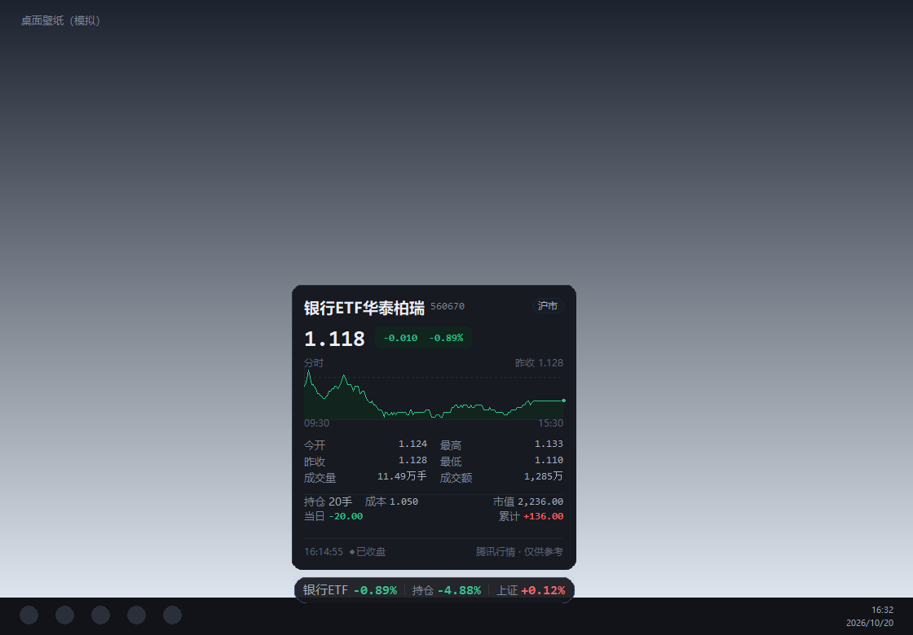
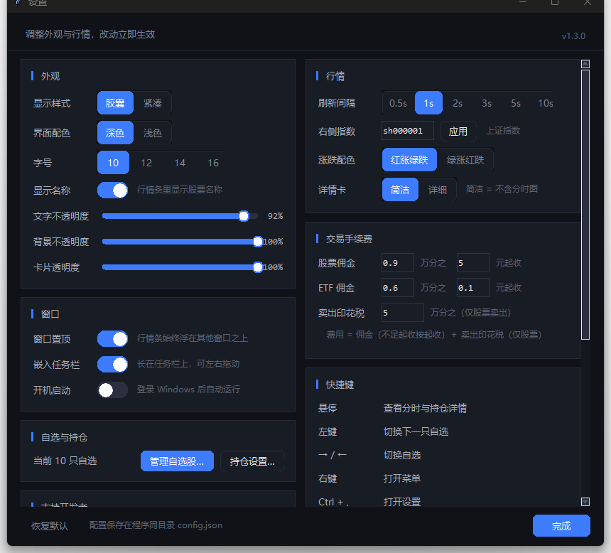
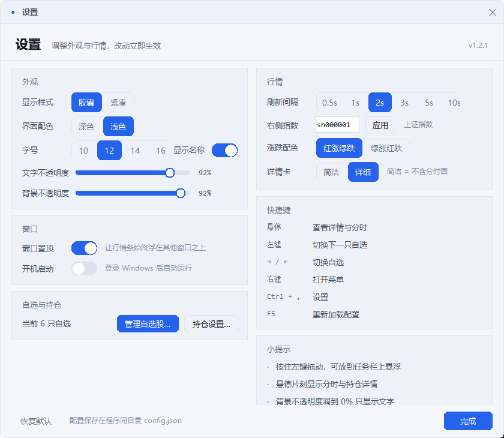
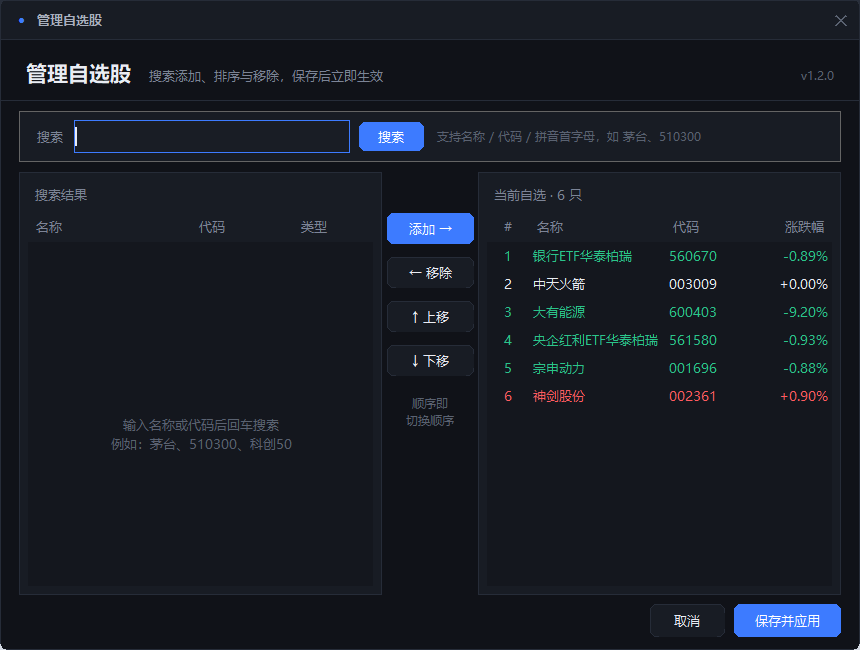
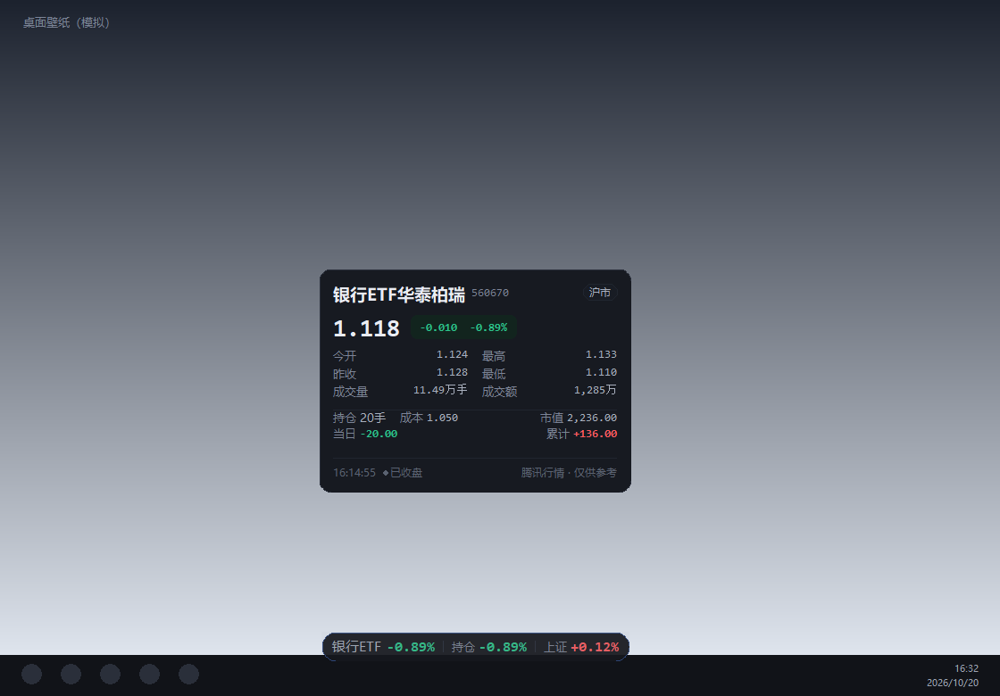
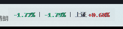
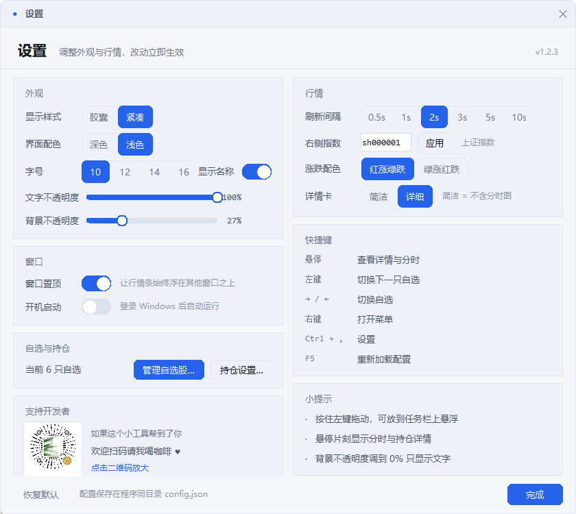

# 上班看盘、摸鱼看盘插件 · StockBar v1.2.3

> 上班看盘、摸鱼看盘插件：悬浮在 Windows 任务栏上的 A 股迷你行情条。像任务栏时间一样小，红涨绿跌一眼扫完，老板路过也不突兀。

一个极简的 Windows 桌面行情条：**胶囊样式、悬浮在桌面/任务栏上，只显示涨跌幅**。
悬停展开详情卡（含当日分时图），右键打开菜单，所有设置图形化调整。

```
贵州茅台  +1.08%  │  持仓 +0.42%  │  上证 +0.35%
```

- 左边：当前自选股涨跌幅（点击 / 方向键切换）
- 中间：持仓当日盈亏（有持仓时才显示）
- 右边：指数涨跌幅
- **红涨绿跌**（可切换绿涨红跌），深色 / 浅色两套主题



## 下载

- [最新版 Releases](https://github.com/gdy4803-maker/stock-bar/releases/latest) → `StockBar-v1.2.3-win64.zip`
- 解压后双击 `看股插件V1.2.3\看股插件V1.2.3.exe`（Windows 10/11 64 位，免安装）
- 源码运行：见下方“方式二”

## v1.2.3 更新

- **支持开发者**：设置窗口左下新增赞赏码卡片（标有“支持开发者”，点击可放大到 320px 扫码），不影响主界面
- **右键菜单自动收起**：鼠标在菜单（含子菜单）内时一直保留；离开菜单 3 秒后自动收起，点击菜单外/按 Esc/选中某项也会立即关闭
- **菜单智能展开**：靠近屏幕底部/右侧时自动向上/向左展开，不再盖住行情条
- **详情卡缩小 1/8**：整体尺寸缩到 87.5%，悬浮时遮挡更少
- **背景不透明度可调到 0**：0% 就是纯文字模式（透明背景），可以只显示涨跌幅
- **详情卡可切换**：简洁（纯文字，不含分时图）/ 详细（含分时图）
- **开机自启更稳**：注册表不可写时自动改用“启动文件夹”的静默脚本；失败时只在设置行内提示，不再弹窗
- 其余为 v1.2 的界面与功能：
- **全新 UI**：圆角胶囊条 + 毛玻璃质感的详情卡；深色 / 浅色主题；数字使用等宽字体，刷新不抖动
- **详情卡**：名称、现价、涨跌、**当日分时图**、今开 / 昨收 / 最高 / 最低 / 成交量额、持仓盈亏（成本、市值、当日、累计）、行情时间与交易状态
- **设置窗口**：样式（胶囊 / 紧凑）、主题、字号、显示名称、文字不透明度、**背景不透明度（可调到 0，只显示文字）**、刷新间隔、右侧指数、涨跌配色、详情卡、窗口置顶、开机自启，全部即时生效
- **自选股管理**：搜索（名称 / 代码 / 拼音首字母）、添加、移除、上移 / 下移排序，保存即生效
- **持仓设置**：表格化展示，填写手数 / 成本价后实时计算当日与累计盈亏
- **更好的兼容性**：高 DPI 清晰渲染、多显示器（含负坐标）、自适应屏幕边界、窗口位置记忆
- **稳定性**：行情线程按代号隔离（切换配置不会串数据）、断线指数退避重连、分时数据缓存、退出时清理定时器与单实例锁
- 修复：右键菜单缺失“编辑配置”、搜索接口编码、`sz000001` 被误判为指数、重复打开管理窗口、持仓行刷新打断输入等问题

## 操作方式

| 操作 | 效果 |
|---|---|
| **悬停** | 展开详情卡：现价、涨跌、**当日分时图**、OHLC、量额、持仓盈亏、行情时间 |
| **左键点击数字区** | 切换到下一只自选 |
| **键盘 → / ←** | 切换自选（先点一下行情条获得焦点；↑ / ↓ 同样可用） |
| **按住拖动** | 拖到任意位置，位置自动记住；可直接拖到任务栏上悬浮 |
| **右键** | 菜单：设置 / 管理自选股 / 持仓设置 / 切换股票 / 刷新间隔 / 置顶 / 复制行情 / 编辑配置 / 退出 |
| **Ctrl + ,** | 打开设置 |
| **Ctrl + M / Ctrl + H** | 管理自选股 / 持仓设置 |
| **Ctrl + C** | 复制当前行情 |
| **F5** | 重新加载 `config.json` |
| **Esc** | 收起详情卡 / 关闭当前窗口 |

## 管理自选股

右键 → **管理自选股…**：

1. 搜索框输入**名称 / 代码 / 拼音首字母**（如 `茅台`、`510300`、`gzmt`），回车或点“搜索”
2. 双击搜索结果（或选中后点 **添加 →**）加入右侧“当前自选”
3. 用 **↑ 上移 / ↓ 下移** 调整顺序（顺序就是点击切换的顺序），双击或 **← 移除** 删除
4. 点 **保存并应用** 立即生效

## 持仓设置

右键 → **持仓设置…**：

- 在上方表格选中一只自选股，填写 **持有手数**（1 手 = 100 股）和 **成本价**（选填）
- 保存后，行情条中间会显示持仓当日盈亏；详情卡与持仓窗口会显示市值、当日盈亏、累计盈亏
- 合计栏实时汇总所有持仓


## 快速开始

### 方式一（推荐）：Releases 压缩包

1. 解压 `StockBar-v1.2.3-win64.zip`，得到 `看股插件V1.2.3\` 文件夹，里面有 `看股插件V1.2.3.exe`、`_internal`、`assets`（赞赏码图片）和 `config.json`
2. 双击文件夹里的 `看股插件V1.2.3.exe` 即可运行（无需 Python、不写系统临时目录、启动更快）
3. 想改自选股：直接用右键菜单里的“管理自选股…”，或记事本编辑 exe 旁边的 `config.json`
4. 单实例：已运行时再次双击不会重复开窗，会闪烁已有窗口提示
5. 想彻底退出：右键条子 → 退出
6. 移动时请**整个 `看股插件V1.2.3` 文件夹一起移动**（`_internal` 里的运行库不能少）

> 已运行旧版时，请先右键退出旧版，再启动新版，避免两个行情条同时显示。

> 为什么不是单文件 exe？PyInstaller 单文件版每次启动都要把自身解压到系统临时目录；部分电脑的临时目录权限受限或被安全软件拦截，会弹出
> `Could not create temporary directory!`。文件夹版不依赖临时目录，直接双击即用，启动也更快。整个文件夹可以放在任意位置，也可以发到别的电脑（Windows 10/11 64 位）。

### 方式二：源码运行

```bat
python stock_bar.py
```

或双击 `启动看股插件.bat`（无黑窗口，会优先使用本机 pythonw）。
源码依赖同目录的 `stock_bar.py`、`sb_data.py`、`sb_theme.py`、`sb_widgets.py`、`sb_ui.py`，请勿单独移动某一个文件。

命令行自检：

```bat
python stock_bar.py --check      :: 拉一次行情，检查代码格式与网络
python stock_bar.py --version
```

## 设置窗口

右键 → **设置…**，或按 `Ctrl + ,`。所有改动即时生效，无需保存。



| 分组 | 项目 |
|---|---|
| 外观 | 显示样式（胶囊 / 紧凑）、界面配色（深色 / 浅色）、字号（10 / 12 / 14 / 16）、显示名称、文字不透明度、背景不透明度（0% = 纯文字） |
| 行情 | 刷新间隔（0.5 / 1 / 2 / 3 / 5 / 10 秒）、右侧指数（如 `000001`、`399001`、`000300`）、涨跌配色（红涨绿跌 / 绿涨红跌）、详情卡（简洁 / 详细） |
| 窗口 | 窗口置顶、开机自动启动 |
| 自选 | 管理自选股、持仓设置 |

> 字号只影响悬浮条；详情卡与设置/管理窗口保持统一的 12pt 界面字号，避免大字号下排版拥挤。

**紧凑模式**只显示数字（`-0.89% │ -4.88% │ 上证 +0.12%`），不显示股票名称，适合屏幕空间紧张时使用。
（原“极简纯文字”模式在透明背景上会因 Windows ClearType 产生彩色描边，v1.2 用同风格的紧凑胶囊替代，观感更干净。）

## 配置文件 config.json

| 字段 | 说明 | 默认 |
|---|---|---|
| `stocks` | 自选股列表（点击 / 方向键依次切换） | 6 只示例 |
| `index` | 右侧固定显示的指数 | `sh000001` |
| `interval_seconds` | 刷新间隔（秒），0.5 ~ 10 | `2` |
| `opacity` | 悬浮条文字不透明度 0.55 ~ 1.0 | `0.92` |
| `bg_opacity` | 胶囊背景不透明度 0 ~ 1；**0 = 只显示文字**（透明背景） | `1.0` |
| `topmost` | 是否始终置顶 | `true` |
| `font_size` | 悬浮条字号 10 / 12 / 14 / 16 | `12` |
| `appearance` | `pill`（胶囊，带名称）或 `compact`（紧凑，仅数字） | `pill` |
| `theme` | `dark` 或 `light` | `dark` |
| `show_name` | 胶囊里是否显示股票名称 | `true` |
| `cn_colors` | `true` = 红涨绿跌，`false` = 绿涨红跌 | `true` |
| `card_mode` | `detail` 详细（含分时图）/ `simple` 简洁（纯文字） | `detail` |
| `window_pos` | 窗口位置（自动记录） | `null` |
| `holdings` | 持仓：`{代码: {"lots": 手数, "cost": 成本价}}` | `{}` |

**代码格式**：直接写纯数字即可，自动识别市场前缀（已带 `sh`/`sz`/`bj`/`hk`/`us` 前缀也能用）：

| 代码开头 | 自动识别为 |
|---|---|
| `60` / `68` / `5` | 沪市（主板 / 科创板 / ETF，如 `600519`、`688981`、`510300`） |
| `00` / `30` / `1` | 深市（主板 / 创业板 / ETF，如 `003009`、`300750`、`159915`） |
| `4` / `8` / `9` | 北交所 |
| `index` 填 `000` 开头 | 上证指数（`000001`）或沪深 300（`000300`） |
| `index` 填 `399` 开头 | 深证指数（如 `399001` 深证成指） |
| `index` 填 `899` 开头 | 北证指数 |

- 港股：`hk` + 5 位代码，如 `hk00700`；美股：`us` + 代码，如 `usAAPL`（须带前缀）
- 注意：`000001` 放在 `stocks` 里是平安银行，放在 `index` 里是上证指数——按所在字段自动区分
- 修改后按 `F5` 或右键“重新加载配置”即时生效

## 常见问题

- **行情条边框变黄 / 数字不动**：网络请求失败，插件会自动退避重试，恢复后边框与数字自动恢复（悬停可见行情时间）
- **键盘 → / ← 没反应**：透明悬浮条需要先左键点一下获得焦点；平时用鼠标点击数字区切换即可
- **数字刷新慢**：A 股行情源本身约 3 秒 / 笔，非交易时段显示最近收盘数据；悬停详情卡会标注“已收盘 / 午间休市 / 交易中”
- **纯文字模式文字边缘略有彩边**：这是 Windows 透明窗口下文字抗锯齿的限制；把“背景不透明度”调到 10% 以上，文字会明显更锐利
- **找不到行情条**：右键菜单 → “回到右下角”；也可以调低不透明度或换“浅色”主题确认位置
- **高 DPI 下文字模糊**：v1.2.3 已启用 Per-Monitor DPI 感知，高分屏下文字为原生清晰渲染
- **多显示器**：可以把行情条拖到任意显示器；重启后会回到上次的位置（若该显示器已断开，会自动夹回可见区域）
- **杀掉进程后单实例锁没释放**：锁文件会在下次启动时检测进程是否存活并自动接管，无需手动删
- **数据来源**：腾讯行情公开接口，免费、低延迟，但可能有延迟或中断，仅作个人参考

## 技术说明

- 数据源：`https://qt.gtimg.cn/` 批量报价；`https://web.ifzq.gtimg.cn/appstock/app/minute/query` 当日分时；`https://smartbox.gtimg.cn/s3/` 搜索联想
- **双窗口**：视觉层（色键透明，只画胶囊/文字，鼠标穿透）+ 交互层（几乎全透明，整块承接拖动/点击/悬停），小字也能轻松命中
- **纯 tkinter Canvas 自绘**：胶囊、详情卡、按钮、开关、滑杆、弹出菜单、圆角对话框全部手绘，不依赖第三方 UI 库，打包体积小
- 分时数据按代码缓存 30 秒；行情线程带代号，配置变化时旧线程结果自动丢弃；失败按 2/4/8/16 秒退避
- 单实例：`stock_bar.lock` 记录 PID + 可执行文件路径，用 `OpenProcess` + `QueryFullProcessImageNameW` 校验，不依赖 tasklist
- 开机自启：写入 `HKCU\Software\Microsoft\Windows\CurrentVersion\Run` 的 `StockBar` 值
- 支持多显示器负坐标、虚拟屏幕边界、任务栏悬浮（与任务栏重叠时把任务栏压到窗口之下）
- 环境：Python 3.10+ + tkinter（Windows 自带），**无第三方依赖**；日志写入同目录 `stock_bar.log`

### 源码结构

| 文件 | 作用 |
|---|---|
| `stock_bar.py` | 入口、悬浮条渲染、交互、配置、单实例、开机自启 |
| `sb_data.py` | 腾讯行情 / 分时 / 搜索、代码规范化、格式化 |
| `sb_theme.py` | 深浅配色、字体、DPI、屏幕几何、圆角绘制、置顶 |
| `sb_widgets.py` | 自绘按钮 / 分段选择 / 开关 / 滑杆 / 弹出菜单 / Treeview 样式 |
| `sb_ui.py` | 详情卡、设置、管理自选股、持仓设置 |

## 打包 exe

推荐**文件夹版**（不依赖系统临时目录，启动更快）：

```bat
python -m pip install pyinstaller
python -m PyInstaller --noconfirm --clean --onedir --windowed --name 看股插件V1.2.3 stock_bar.py
```

生成 `dist\看股插件V1.2.3\看股插件V1.2.3.exe`，`_internal` 文件夹要一起保留/分发；再把源码目录的 `assets` 文件夹复制到 `dist\看股插件V1.2.3\assets`（赞赏码图片）。

如果确定目标电脑的临时目录可用，也可以打单文件版：

```bat
python -m PyInstaller --noconfirm --clean --onefile --windowed --name 看股插件V1.2.3 stock_bar.py
```

单文件版在临时目录受限的电脑上可能报 `Could not create temporary directory!`，此时请改用文件夹版。仓库里的 `看股插件.spec` 是单文件配置，按需修改 `name`/`onedir` 即可。

## 截图

| 深色主题 | 浅色主题 |
|---|---|
|  |  |

| 自选股管理 | 紧凑模式 |
|---|---|
|  |  |

| 简洁详情卡（无分时图） | 纯文字（背景不透明度 0%） |
|---|---|
|  |  |

| 设置里的支持开发者卡片 | 点击后的赞赏码 |
|---|---|
|  |  |

> 截图中的桌面 / 任务栏为测试用模拟背景。

> 免责声明：行情数据来自公开免费接口，可能存在延迟或中断，仅作个人参考，不构成投资建议。

## License

MIT License © 2026 StockBar contributors

> 行情数据来自公开免费接口，仅作个人参考，不构成投资建议。
