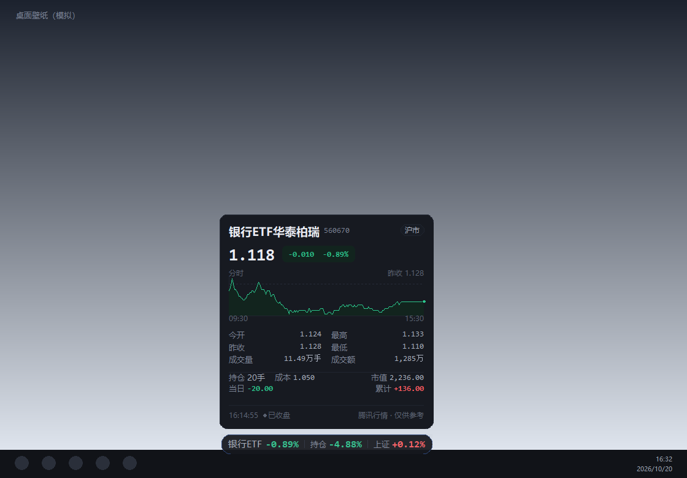
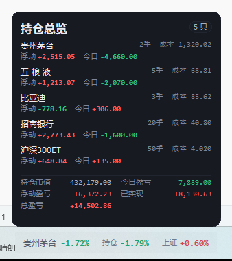
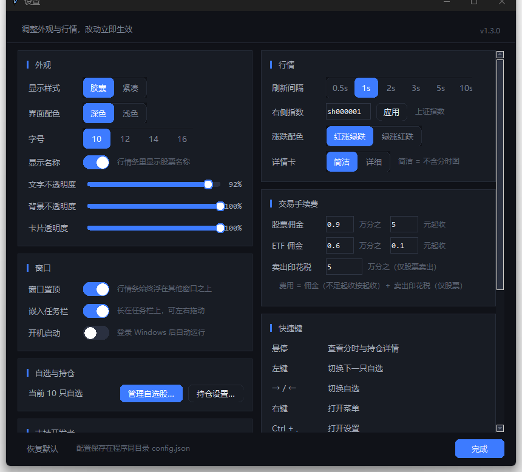
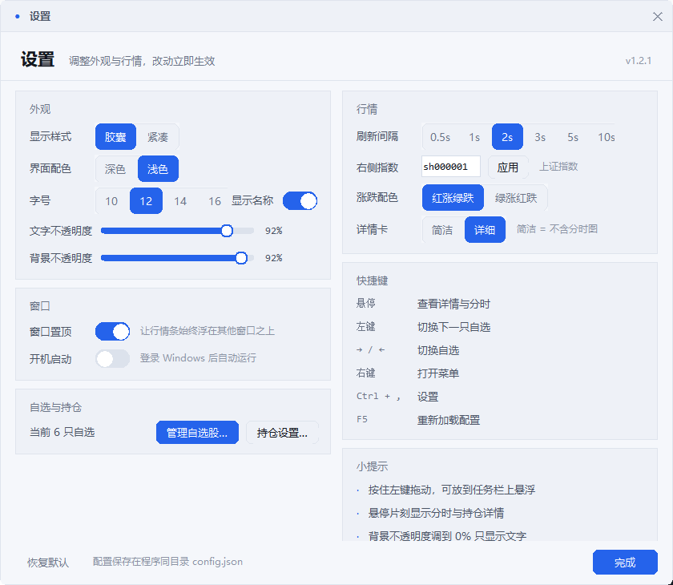
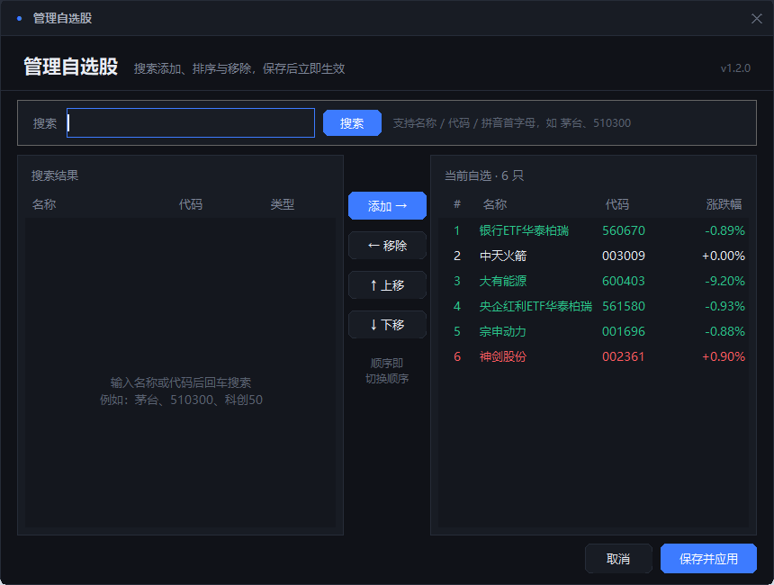

<div align="center">

# 📈 看股插件 · StockBar

### 桌面端 A 股实时行情悬浮胶囊

**一行代码不用写，双击即用的看盘神器**
实时行情 · 集合竞价 · AI 研判 · 智能选股 · 模拟持仓 · 三源容灾

[⬇️ 下载](https://github.com/gdy4803-maker/stock-bar/releases/latest) · [📖 使用帮助](#-快速开始) · [📝 更新日志](CHANGELOG.md) · [🌟 点个 Star](https://github.com/gdy4803-maker/stock-bar)

*Windows 10/11 · 纯 Python 标准库 · 免安装 · 完全免费*

</div>

---

## 🎯 为什么选择看股插件

| | 看股插件 | 传统行情软件 |
|---|---|---|
| **打扰度** | 悬浮胶囊，1 行文字的体量 | 占满半个屏幕 |
| **开机即用** | 双击 exe，2 秒就绪 | 安装、登录、开屏广告 |
| **资源占用** | 内存 < 100MB | 动辄数百 MB |
| **看盘效率** | 盘口/分时/持仓/AI，悬停即看 | 层层点击 |
| **隐私安全** | 数据只在本地 | 账号体系、行为采集 |

> 把「看一眼行情」这件事，做到极致轻量。

---

## ✨ 核心功能

### 🩵 悬浮行情胶囊
- **胶囊 / 紧凑** 双形态：一只股票涨跌 + 持仓盈亏 + 指数，一屏尽览
- **自由拖动 / 嵌入任务栏**：可长在任务栏上左右滑动，**记住你的位置**
- **深色 / 浅色** 主题、字号 10–16、透明度自由调（背景 0% = 纯文字极简模式）
- **分区点击**：点个股区切换股票、点持仓区切换金额/涨幅

### 📊 详情卡片
- 悬停即看：**同花顺式分时图**（固定 9:30–15:00、高低点标注、昨收虚线）
- **买卖一报价 × 金额**、盘口、持仓明细、今日盈亏
- 按 `1 / 2 / 3` 切换：个股 / 持仓总览 / **竞价评分**

### 🔥 集合竞价 · AI 研判（独家）
- **9:15–9:25 实时竞价走势**：虚拟撮合价曲线 + **买卖压力柱**（红=买压 绿=卖压）
- **竞价评分卡**：5 项可解释评分（高开幅度/撮合趋势/买卖力量/量价配合/价格稳定）
- **AI 研判**：接入 DeepSeek / MIMO 大模型，综合
  **技术指标（MACD/KDJ/RSI/布林）+ 基本面 + RPS 相对强度 + 历史统计** 给出独立判断
- 每天自动训练评分权重（纯 Python 逻辑回归），**越用越准**

### 🎯 智能选股（借鉴经典量化策略）
- **收盘选股**：海龟突破 / RPS 突破 / 放量突破 / 高窄旗形 / 涨停洗盘 / 跌停反包 / 强势回调
  —— 7 大策略自由勾选，命中越多越可靠
- **自选强弱排序**：RPS 相对强度一目了然
- **当日异动扫描**：全市场放量大涨股，双击即可加入自选

### 💼 模拟持仓（模拟盘）
- 买入填成本、卖出填卖价，**费用按费率自动计算**（股票/ETF 分开、卖出含印花税）
- 今日盈亏按**分批口径**精确计算（老仓按昨收、今日买入按成本）
- 实时市值 / 浮动盈亏 / 已实现 / 总盈亏

### 📈 个股详情窗
- 自选切换 · **分时 / 5 日 / K 线** · 指标 · 盘口十档
- **涨跌停价 · 支撑压力位** · 板块概念标签
- AI 快速解读

---

## 🚀 快速开始

### 方式一 · 直接运行（推荐）

1. 前往 [Releases](https://github.com/gdy4803-maker/stock-bar/releases/latest) 下载 `StockBar-vX.X.X-win64.zip`
2. 解压到任意目录，双击 `看股插件V*.exe`
3. 右键悬浮条 → **管理自选股…**，添加你的股票
4. 按 `Ctrl + Shift + S` 打开设置，按需调整

> 📦 **绿色免安装**：整个文件夹即程序本体，拷贝到 U 盘也能跑。
> ⚠️ 移动/重命名时请**连同文件夹一起**操作，`_internal` 是运行时依赖。

### 方式二 · 源码运行

```bash
python stock_bar.py
```

自检与版本：

```bash
python stock_bar.py --check
python stock_bar.py --version
```

---

## ⌨️ 快捷键

| 快捷键 | 功能 |
|---|---|
| **悬停** | 查看详情卡（分时 / 持仓 / 竞价评分） |
| **左键** | 切换下一只自选 |
| **→ / ←** | 切换自选 |
| **1 / 2 / 3** | 切换卡片：个股 / 持仓总览 / 竞价评分（需悬浮在行情条上） |
| **T** | 打开评分卡并触发 AI 研判 |
| **右键** | 打开菜单 |
| **Ctrl + Shift + S** | 打开设置 |
| **Ctrl + M / Ctrl + H** | 管理自选股 / 持仓设置 |
| **Ctrl + C** | 复制当前行情 |
| **F1** | 使用帮助（11 节教程） |
| **F5** | 重新加载配置 |
| **Esc** | 关闭卡片 / 窗口 |

---

## ⚙️ 设置一览

右键 → **设置…**（或 `Ctrl + Shift + S`），所有改动**即时生效、自动保存**。

| 分类 | 可调项 |
|---|---|
| **外观** | 胶囊/紧凑、深色/浅色、字号、显示名称、文字/背景/卡片透明度 |
| **窗口** | 置顶、嵌入任务栏、开机启动 |
| **行情** | 刷新间隔、请求时段、右侧指数、涨跌配色、持仓显示、详情卡模式 |
| **AI 研判** | 自动研判开关、服务商（DeepSeek / MIMO / 自定义）、接口、模型、Key |
| **交易手续费** | 股票佣金 / ETF 佣金 / 卖出印花税（全自动计算） |

> 🔐 API Key 支持**环境变量 `STOCKBAR_LLM_KEY`**，不落盘更安全。

---

## 📁 配置文件 config.json

配置保存在程序同目录，**升级/打包永不丢失**，可直接复制到别的机器。

| 字段 | 说明 |
|---|---|
| `stocks` | 自选股列表（自动识别 sh/sz/bj/hk/us 市场前缀） |
| `index` | 右侧指数（`sh000001` / `sz399001` / `sh000300` …） |
| `interval_seconds` | 刷新间隔 0.5–10 秒 |
| `opacity` / `bg_opacity` / `card_opacity` | 文字 / 背景 / 卡片透明度 |
| `theme` / `font_size` / `appearance` | 主题、字号、胶囊/紧凑 |
| `cn_colors` | 红涨绿跌 / 绿涨红跌 |
| `fetch_mode` | `trading`（交易时段）/ `all`（全天） |
| `holdings` | 模拟盘成交记录 |
| `fees` | 手续费规则 |
| `llm_*` | AI 研判服务商、接口、模型、Key |

**代码格式**：`60/68/5`=沪、`00/30/1`=深、`4/8/9`=北、`hk`+5 位=港股、`us`+代码=美股。

---

## 🛠️ 技术架构

- **纯 Python 标准库**（3.10+ / tkinter）——**零第三方依赖**，无打包体积焦虑
- **三源行情容灾**：腾讯 + 新浪（实时合并）→ 东财兜底，单源失效不断流
- **MCP 历史数据**：基本面 / 历史统计 / 技术指标（开源数据服务，免费）
- **异步取数线程 + 看门狗**：网络抖动自动恢复，退避重试
- **自绘 UI**：圆角按钮 / 开关 / 滑杆 / 分段器 / 自定义菜单 / 表格样式，全 Canvas 渲染
- **自动更新**：一键下载安装，配置数据无缝保留

### 源码结构

| 文件 | 职责 |
|---|---|
| `stock_bar.py` | 主程序：行情条渲染、轮询、快捷键、更新 |
| `sb_data.py` | 数据层：腾讯/新浪/东财行情、MCP、评分、选股策略 |
| `sb_ui.py` | 界面：详情卡、设置、自选管理、模拟盘、选股 |
| `sb_detail.py` | 个股/指数详情窗：分时/5日/K线、盘口、涨跌停 |
| `sb_ai.py` | AI 研判：提示词、输出校验、结论对齐 |
| `sb_sector.py` | 板块概念标签 |
| `sb_levels.py` | 智能选股价位（支撑/压力/止盈止损） |
| `sb_theme.py` | 主题 / 字体 / DPI / 屏幕几何 |
| `sb_widgets.py` | 对话框控件库 |

---

## 🔒 安全与隐私

- ✅ **完全免费开源**（MIT），无账号体系、无行为采集
- ✅ AI Key 可走**环境变量**，不写入任何配置文件
- ✅ 数据只在本地：`config.json` / `auction_data\` / `stock_bar.log`
- ✅ 发布包为**虚构演示配置**，绝不含任何真实密钥

---

## ❓ 常见问题

| 问题 | 解决 |
|---|---|
| 双击无反应 / 闪退 | 用命令行运行 `看股插件.exe` 看报错；或先装 VC 运行库 |
| 行情不刷新 | 检查网络；改「刷新间隔」；收盘后为静态行情属正常 |
| 透明度调低后按钮难点 | 这是 Windows 半透明窗口特性；调回 90%+ 或换浅色主题 |
| 高分屏模糊 | v1.2.9+ 已支持 Per-Monitor DPI 感知 |
| 多显示器 | 支持跨屏移动、位置自动记忆 |

> 更多教程请按 **F1** 打开内置「使用帮助」。

---

## 📸 截图

> 截图均为**虚构演示数据**，不含任何真实持仓信息。

| 悬浮卡片 | 持仓总览 |
|---|---|
|  |  |

| 深色主题 | 浅色主题 |
|---|---|
|  |  |

| 管理自选 | 紧凑模式 |
|---|---|
|  |  |

---

## 📄 开源协议

[MIT License](LICENSE) · 仅供学习研究，**不构成任何投资建议**
数据来自公开行情接口，准确性与及时性以交易所为准。

<div align="center">

**如果这个小工具帮到了你，请给仓库点一颗 ⭐ Star，谢谢！**

</div>
