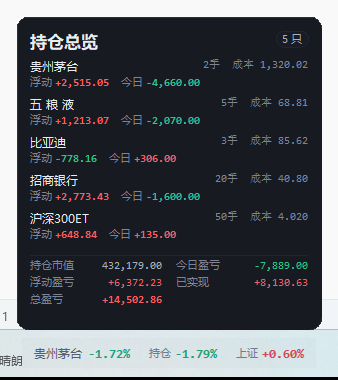
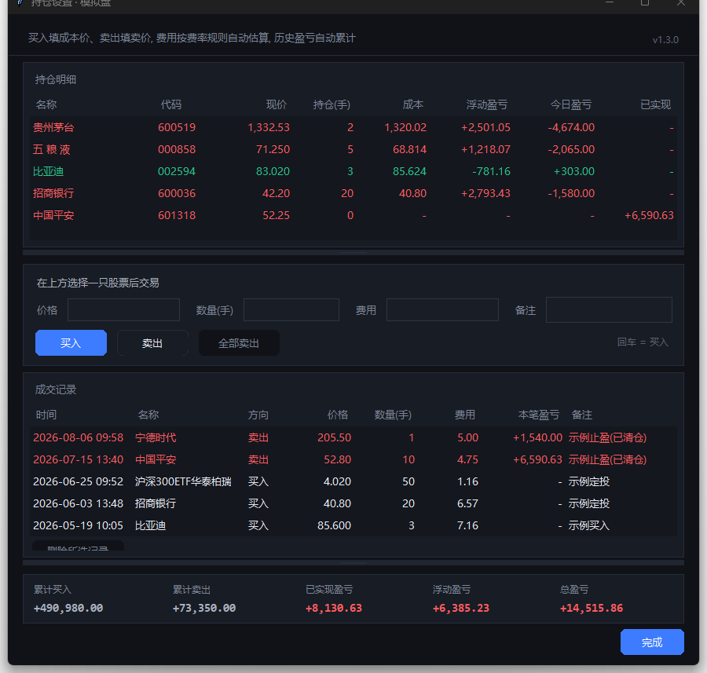

# 沪深实时行情桌面导航栏 (StockBar)

一个极简的 Windows 桌面 **股票悬浮窗**（大A · A股实时行情条）：**胶囊样式、悬浮在桌面/任务栏上，只显示涨跌幅**。
沪深大盘、个股涨跌幅、持仓盈亏随手一瞥，**分区悬停**展开详情卡（个股=当日分时、持仓=总览卡、指数=分时），
右键打开菜单，所有设置图形化调整，上班摸鱼看盘、盯大A神器。

```
贵州茅台  +1.08%  │  持仓 +0.42%  │  上证 +0.35%
```

- 左边：当前自选股涨跌幅（点击 / 方向键切换）——悬停看**个股分时详情**
- 中间：持仓当日盈亏（有持仓时才显示）——悬停看**持仓总览卡**（每只持仓+汇总）
- 右边：指数涨跌幅——悬停看**指数分时**
- **红涨绿跌**（可切换绿涨红跌），深色 / 浅色两套主题


## v1.3.6 更新

### 修复（集合竞价时段"卡住不刷新"，**未验证**）
- **分时只有 1 个数据点时渲染抛异常**——集合竞价（9:15–9:25）刚开始时分时恰好只有 1 个点，
  `create_line` 因坐标不足抛 `wrong # coordinates`，渲染中断、界面看起来卡住（未验证）
- **单条消息处理失败不再拖垮数据轮询链**——渲染异常会让刷新循环永久停摆、数据再也不更新，
  现在单条失败只记日志、轮询继续（未验证）
- 菜单二级展开时的 `bad window path name` 异常（未验证）

> 以上修复需在下一个交易日的集合竞价时段（9:15–9:25）观察验证。


## v1.3.5 更新（自 v1.3.1）

### 修复
- **模拟盘「今日盈亏」重算**——每一份股数都有**参考价**，离场/持有都结算：

  | 股数来源 | 参考价 | 结算价 |
  |---|---|---|
  | 昨日就有的 | 昨收 | 现价（仍持有）/ 卖出价（今天卖出） |
  | 今天买入的 | 买入价 | 现价（仍持有）/ 卖出价（今天卖出） |

  今日成交按时间 **FIFO**：卖出先消耗最老的份额并当场结算。
  **当天买入后卖出、当天清仓，同样有今日盈亏**。持仓总览卡的明细也会列出**今天清仓**的股票（0 手 / 成本 / 浮动 - / 今日盈亏，与正常行一致），更早的清仓不列，但今日盈亏合计都包含（此前会被漏算）。
  样例：今 10 元买 5 手、11 元卖 4 手、剩 1 手现价 10.5 → `(11−10)×400 + (10.5−10)×100 = +450`

- **数据不再卡住不刷新**：取数单源卡死不再拖垮整体（有界等待 + 超时取消）、DNS 解析超时兜底、**20 秒无数据自动重启取数线程**（看门狗）
- 修复拖动窗口崩溃（撤除实验性窗口过程钩子，恢复稳定）

### 新增
- **持仓显示切换**：设置 → 行情 → 持仓显示【金额 / 涨幅】，行情条中间段实时切换
- **右键菜单勾选即时翻转**：「窗口置顶」「嵌入任务栏」「切换股票」「刷新间隔」点击后**菜单留开、勾选就地翻转**，可连续切换多项
- **菜单智能收起**：鼠标在菜单上（含二级菜单）一直保留；打开后没悬停 **0.6 秒**收起；悬停过又移开 **0.2 秒**收起

> v1.3.2 ~ v1.3.4 为内部稳定性迭代（拖动崩溃的修复与回退），功能以 v1.3.5 为准。


## v1.3.0 更新

- **分区悬停**：行情条分三段，悬停不同段弹不同卡片——个股段=个股分时详情、**持仓段=持仓总览卡**、指数段=指数分时
- **持仓总览卡**：悬停即看真实持仓（每只两行：名称 / 持仓 / 成本 + 浮动盈亏 / 今日盈亏），底部汇总（市值 / 今日 / 浮动 / 已实现 / 总盈亏）；只列当前持仓，清仓股历史盈亏计入汇总
- 卡片透明度、红涨绿跌配色对新卡同样生效




## v1.2.9 更新

- **对话框改正宗 Windows 窗口**（设置 / 管理自选股 / 持仓设置）：**系统标题栏**（拖动、双击、Alt+Space 系统菜单、原生关闭按钮）+ **原生 8 向缩放**（拖边缘/角落、Win+方向键贴边、缩放动画、最小尺寸由系统限制）+ Win11 系统圆角；深色主题下标题栏自动为深色
- **新增：悬停卡片透明度**——设置「外观」区新增滑杆（10%~100%），鼠标悬停弹出的行情详情卡可整体透明，拖动即时生效并记忆
- 移除约 150 行自绘标题栏/手绘圆角/手写缩放代码，顺带根治 `SetWindowRgn` 与窗口移动的竞态
- 窗口内不再重复显示大标题（标题已在系统标题栏），保留副标题行

- **已知问题**：拖动缩放窗口时内容有约 1 帧的跟手延迟（Tk 框架在系统缩放循环中的固有行为，优先保证稳定性）；如需极致顺滑可后续提供实验性优化开关

## v1.2.8 更新

- **持仓设置窗口可自由拉伸**：4 边 + 4 角共 **8 个方向**缩放（与普通 Windows 窗口一致），带最小尺寸限制、贴近屏幕底部自动上移腾空间
- **两个列表各有一条分割把手**：上下拖动调节「持仓明细 / 成交记录」高度（各有最小值），下方组件随之移动
- **响应式布局**：窗口拉高时多余高度按比例分给两个列表；价格/数量/费用/备注改为四等分网格，窗口越宽输入框越长
- **布局记忆**：窗口尺寸与两个列表高度写入配置，下次打开原样恢复
- **修复拖动卡顿与位置怪相**：定位到 `SetWindowRgn`（画圆角）紧跟 `geometry()` 会把未生效的移动冲掉（只变尺寸不变位置）；改为圆角延后合并补画 + 拖动中不再强制同步重排，每次拖动 **0.01ms**（原约 1ms+ 且界面卡）

## v1.2.7 更新

- **新增：持仓设置升级为「模拟盘」**——买入填成本价、卖出填卖价，自动推导持仓/均价/浮动盈亏/**已实现盈亏（历史累计）**；成交记录可删除并全量重算；支持加仓、部分卖出、全部卖出，超卖自动拦截
- **新增：交易手续费设置**（设置 → 交易手续费）——股票佣金 万0.9 起收 5 元、ETF 佣金 万0.6 起收 0.1 元、卖出印花税 万5（仅股票），全部可改；交易时费用自动估算、也可手改
- **详情卡持仓小节**增加 成本 / 已实现 / 浮动盈亏
- **会计口径**：平均成本法，买入费用计入成本，卖出按当时均价结算已实现盈亏
- 旧版「手数+成本价」持仓自动迁移为一条期初持仓记录，历史连续
- 界面：交易表单排版加宽（价格/数量/费用/备注分组留白），移除与行情条重复的涨跌幅列

## v1.2.6 更新

- **行情更快**：腾讯 + 新浪**双源并发**，按行情时间戳取更新的那条。交易所 Level-1 快照约 3 秒一拍，两个源刷新相位不同，合并后优于任一单源（实测 20 轮中新浪贡献了 20% 的更早新价，最快提前 3 秒）
- 数据层单源失败自动降级为另一源；新浪单位已对齐腾讯（手/万元）
- 说明：想要逐笔级（毫秒）速度需要 Level-2 行情（券商/付费数据商），免费公开接口都是 3 秒快照口径

## v1.2.5 更新

- **新增：嵌入任务栏**——像天气组件一样"长"在任务栏里：文字直接落在任务栏上（无悬浮底色）、自动扫描任务栏找空位（避开天气组件/开始按钮/图标）、可左右拖动微调、任务栏换位置自动跟随；设置「窗口」区或右键菜单均可开关
- **修复：打包版「开机启动」打不开**——火绒等安全软件的「启动项防护」会拦截程序写注册表/启动文件夹（三种写入全被拒绝）；现在自动改用**计划任务（登录触发）**这条通道，任一成功即开启，全部失败时给出安全软件白名单/信任区的解决指引
- **修复：窗口位置偶发不生效**——Tk 的 geometry() 是异步的，会被随后的层级维护(SetWindowPos)冲掉，导致嵌入/移动后窗口留在原地；现在几何变更立即落位

## v1.2.4 更新

- **修复：菜单“窗口置顶”开关失效**——关闭置顶时只做了窗口排序、没清顶层框架的 WS_EX_TOPMOST，导致永远压在最上；现在真正设置/取消置顶位
- **修复：快捷键失效**——层级维护的窗口操作会偷偷抢走键盘焦点（缺 SWP_NOACTIVATE），点一下过会儿快捷键就不灵；现在层级调整不再抢焦点，并把 OS 焦点真正交给交互层/对话框/菜单
- **修复：设置窗口卡顿**（拖滑杆/点按钮半天才反应）——根因是每次改动都对屏幕做慢速像素采样（约 1.2 秒/次）；改为 BitBlt 快速采样 + 壁纸缓存 + 窗口属性按需设置，一次设置变更从 ~1200ms 降到 ~3ms
- **修复：背景与文字透明度完全独立**——之前调背景透明度时文字会跟着变淡；现在两个滑杆各管各的
- **修复：文字发虚/彩边**——文字抗锯齿的混色自动对准背后的实际合成色（胶囊底色按透明度混入壁纸采样色），任何透明度、任何壁纸下都锐利
- **修复：文字隐形**——文字颜色随背景明暗自适应；背景调淡后灰色文字自动转深色，不再与浅色背景同色
- **修复：纯文字模式的浅灰框**——交互层垫底从 2% 降到 1/255，肉眼不可见但仍能点击
- **修复：点击偶发失效**——窗口属性设置会打乱 z 序导致点击被背景层吞掉，现在自动恢复层级（卡片/菜单/对话框仍在最上）
- **修复：全新配置背景默认 100%**（旧配置自动迁移，视觉不变）

## v1.2.3 更新

- **支持开发者**：设置窗口左下新增赞赏码卡片（标有“支持开发者”，点击可放大到 320px 扫码），不影响主界面
- **右键菜单自动收起**：鼠标在菜单（含子菜单）内时一直保留；离开菜单 3 秒后自动收起，点击菜单外/按 Esc/选中某项也会立即关闭
- **菜单智能展开**：靠近屏幕底部/右侧时自动向上/向左展开，不再盖住行情条
- **详情卡缩小 1/8**：整体尺寸缩到 87.5%，悬浮时遮挡更少
- **背景不透明度可调到 0**：0% 就是纯文字模式（透明背景），可以只显示涨跌幅
- **详情卡可切换**：简洁（纯文字，不含分时图）/ 详细（含分时图）
- **开机自启更稳**：注册表不可写时自动改用“启动文件夹”的静默脚本；失败时只在设置行内提示，不再弹窗
- 其余为 v1.2 的界面与功能：
- **全新 UI**：圆角胶囊条 + 毛玻璃质感的详情卡；深色 / 浅色主题；数字使用等宽字体，刷新不抖动
- **详情卡**：名称、现价、涨跌、**当日分时图**、今开 / 昨收 / 最高 / 最低 / 成交量额、持仓盈亏（成本、市值、当日、累计）、行情时间与交易状态
- **设置窗口**：样式（胶囊 / 紧凑）、主题、字号、显示名称、文字不透明度、**背景不透明度（可调到 0，只显示文字）**、刷新间隔、右侧指数、涨跌配色、详情卡、窗口置顶、开机自启，全部即时生效
- **自选股管理**：搜索（名称 / 代码 / 拼音首字母）、添加、移除、上移 / 下移排序，保存即生效
- **持仓设置**：表格化展示，填写手数 / 成本价后实时计算当日与累计盈亏
- **更好的兼容性**：高 DPI 清晰渲染、多显示器（含负坐标）、自适应屏幕边界、窗口位置记忆
- **稳定性**：行情线程按代号隔离（切换配置不会串数据）、断线指数退避重连、分时数据缓存、退出时清理定时器与单实例锁
- 修复：右键菜单缺失“编辑配置”、搜索接口编码、`sz000001` 被误判为指数、重复打开管理窗口、持仓行刷新打断输入等问题

## 操作方式

| 操作 | 效果 |
|---|---|
| **悬停个股段** | 个股详情卡：现价、涨跌、**当日分时图**、OHLC、量额、持仓盈亏、行情时间 |
| **悬停持仓段** | **持仓总览卡**：每只持仓（名称/持仓/成本/浮动/今日）+ 市值/今日/浮动/已实现/总盈亏汇总 |
| **悬停指数段** | 指数详情卡：当日分时图 + 指数明细 |
| **左键点击数字区** | 切换到下一只自选 |
| **键盘 → / ←** | 切换自选（先点一下行情条获得焦点；↑ / ↓ 同样可用） |
| **按住拖动** | 拖到任意位置，位置自动记住；可直接拖到任务栏上悬浮 |
| **右键** | 菜单：设置 / 管理自选股 / 持仓设置 / 切换股票 / 刷新间隔 / 置顶 / 复制行情 / 编辑配置 / 退出 |
| **Ctrl + ,** | 打开设置 |
| **Ctrl + M / Ctrl + H** | 管理自选股 / 持仓设置 |
| **Ctrl + C** | 复制当前行情 |
| **F5** | 重新加载 `config.json` |
| **Esc** | 收起详情卡 / 关闭当前窗口 |

## 管理自选股

右键 → **管理自选股…**：

1. 搜索框输入**名称 / 代码 / 拼音首字母**（如 `茅台`、`510300`、`gzmt`），回车或点“搜索”
2. 双击搜索结果（或选中后点 **添加 →**）加入右侧“当前自选”
3. 用 **↑ 上移 / ↓ 下移** 调整顺序（顺序就是点击切换的顺序），双击或 **← 移除** 删除
4. 点 **保存并应用** 立即生效

## 持仓设置 · 模拟盘

右键 → **持仓设置…**（一个完整的模拟盘）：

- **买卖交易**：选中自选股后填 **价格 / 数量（手）** 即可买入卖出，费用按费率规则自动估算（可自定义万费率与起收）
- **成交记录**：每笔买卖自动记录时间/方向/价格/数量/费用/本笔盈亏，卖出时自动累计已实现盈亏，支持清仓回补
- **持仓明细**：实时显示每只持仓的现价、持仓、成本、浮动盈亏、今日盈亏、已实现
- **今日盈亏**按「份额参考价」计算：昨日股数看昨收、当日新买看买入价；卖出即结算，**当天买卖、当天清仓都计入今日盈亏**
- **汇总**：累计买入 / 累计卖出 / 已实现 / 浮动盈亏 / 总盈亏 实时统计
- 鼠标**悬停行情条持仓段**，还会弹出**持仓总览卡**随时查看



## 快速开始

### 方式一（推荐）：双击 `dist\看股插件V1.3.0\看股插件V1.3.0.exe`

1. `dist\看股插件V1.3.0\` 是一个**免安装文件夹版**，里面有 `看股插件V1.3.0.exe`、`_internal`、`assets`（赞赏码图片）和 `config.json`
2. 双击文件夹里的 `看股插件V1.3.0.exe` 即可运行（无需 Python、不写系统临时目录、启动更快）
3. 想改自选股：直接用右键菜单里的“管理自选股…”，或记事本编辑 exe 旁边的 `config.json`
4. 单实例：已运行时再次双击不会重复开窗，会闪烁已有窗口提示
5. 想彻底退出：右键条子 → 退出
6. 移动时请**整个 `看股插件V1.3.0` 文件夹一起移动**（`_internal` 里的运行库不能少）

> 旧版（V1.2.x 及更早）如果还在运行，请先右键退出，再启动新版本，避免两个行情条同时显示。确认新版正常后，旧文件夹可以删除。

> 为什么不是单文件 exe？PyInstaller 单文件版每次启动都要把自身解压到系统临时目录；部分电脑的临时目录权限受限或被安全软件拦截，会弹出
> `Could not create temporary directory!`。文件夹版不依赖临时目录，直接双击即用，启动也更快。整个文件夹可以放在任意位置，也可以发到别的电脑（Windows 10/11 64 位）。

### 方式二：源码运行

```bat
python stock_bar.py
```

或双击 `启动看股插件.bat`（无黑窗口，会优先使用本机 pythonw）。
源码依赖同目录的 `stock_bar.py`、`sb_data.py`、`sb_theme.py`、`sb_widgets.py`、`sb_ui.py`，请勿单独移动某一个文件。

命令行自检：

```bat
python stock_bar.py --check      :: 拉一次行情，检查代码格式与网络
python stock_bar.py --version
```

## 设置窗口

右键 → **设置…**，或按 `Ctrl + ,`。所有改动即时生效，无需保存。


| 分组 | 项目 |
|---|---|
| 外观 | 显示样式（胶囊 / 紧凑）、界面配色（深色 / 浅色）、字号（10 / 12 / 14 / 16）、显示名称、文字不透明度、背景不透明度（0% = 纯文字）、**卡片透明度**（10%~100%） |
| 行情 | 刷新间隔（0.5 / 1 / 2 / 3 / 5 / 10 秒）、右侧指数（如 `000001`、`399001`、`000300`）、涨跌配色（红涨绿跌 / 绿涨红跌）、详情卡（简洁 / 详细） |
| 窗口 | 窗口置顶、嵌入任务栏（像天气组件一样长在任务栏上）、开机自动启动 |
| 自选与持仓 | 管理自选股、持仓设置（模拟盘） |
| 交易手续费 | 股票佣金 / ETF 佣金 / 卖出印花税（万费率 + 起收，全部可自定义） |

> 设置 / 管理自选股 / 持仓设置 都是**正宗 Windows 窗口**：系统标题栏（可拖动、双击、Alt+Space）+ **原生 8 向缩放**（Win+方向键贴边、缩放动画、最小尺寸保护）。

> 字号只影响悬浮条；详情卡与设置/管理窗口保持统一的 12pt 界面字号，避免大字号下排版拥挤。

**紧凑模式**只显示数字（`-0.89% │ -4.88% │ 上证 +0.12%`），不显示股票名称，适合屏幕空间紧张时使用。
（原“极简纯文字”模式在透明背景上会因 Windows ClearType 产生彩色描边，v1.2 用同风格的紧凑胶囊替代，观感更干净。）

## 配置文件 config.json

| 字段 | 说明 | 默认 |
|---|---|---|
| `stocks` | 自选股列表（点击 / 方向键依次切换） | 6 只示例 |
| `index` | 右侧固定显示的指数 | `sh000001` |
| `interval_seconds` | 刷新间隔（秒），0.5 ~ 10 | `2` |
| `opacity` | 悬浮条文字不透明度 0.10 ~ 1.0 | `0.92` |
| `bg_opacity` | 胶囊背景不透明度 0 ~ 1；**0 = 只显示文字**（透明背景） | `1.0` |
| `topmost` | 是否始终置顶 | `true` |
| `font_size` | 悬浮条字号 10 / 12 / 14 / 16 | `12` |
| `appearance` | `pill`（胶囊，带名称）或 `compact`（紧凑，仅数字） | `pill` |
| `theme` | `dark` 或 `light` | `dark` |
| `show_name` | 胶囊里是否显示股票名称 | `true` |
| `cn_colors` | `true` = 红涨绿跌，`false` = 绿涨红跌 | `true` |
| `card_mode` | `detail` 详细（含分时图）/ `simple` 简洁（纯文字） | `detail` |
| `card_opacity` | 悬停卡片透明度 0.10 ~ 1.0 | `1.0` |
| `window_pos` | 窗口位置（自动记录） | `null` |
| `holdings` | 模拟盘成交记录 `{代码: {"trades": [{time, side, price, lots, fee, note}]}}`（用「持仓设置」图形界面维护，不建议手改） | `{}` |
| `fees` | 手续费规则：股票/ETF 万费率、起收、印花税 | 见默认值 |

**代码格式**：直接写纯数字即可，自动识别市场前缀（已带 `sh`/`sz`/`bj`/`hk`/`us` 前缀也能用）：

| 代码开头 | 自动识别为 |
|---|---|
| `60` / `68` / `5` | 沪市（主板 / 科创板 / ETF，如 `600519`、`688981`、`510300`） |
| `00` / `30` / `1` | 深市（主板 / 创业板 / ETF，如 `003009`、`300750`、`159915`） |
| `4` / `8` / `9` | 北交所 |
| `index` 填 `000` 开头 | 上证指数（`000001`）或沪深 300（`000300`） |
| `index` 填 `399` 开头 | 深证指数（如 `399001` 深证成指） |
| `index` 填 `899` 开头 | 北证指数 |

- 港股：`hk` + 5 位代码，如 `hk00700`；美股：`us` + 代码，如 `usAAPL`（须带前缀）
- 注意：`000001` 放在 `stocks` 里是平安银行，放在 `index` 里是上证指数——按所在字段自动区分
- 修改后按 `F5` 或右键“重新加载配置”即时生效

## 常见问题

- **行情条边框变黄 / 数字不动**：网络请求失败，插件会自动退避重试，恢复后边框与数字自动恢复（悬停可见行情时间）
- **键盘 → / ← 没反应**：透明悬浮条需要先左键点一下获得焦点；平时用鼠标点击数字区切换即可
- **数字刷新慢**：A 股行情源本身约 3 秒 / 笔，非交易时段显示最近收盘数据；悬停详情卡会标注“已收盘 / 午间休市 / 交易中”
- **纯文字模式文字边缘略有彩边**：这是 Windows 透明窗口下文字抗锯齿的限制；把“背景不透明度”调到 10% 以上，文字会明显更锐利
- **找不到行情条**：右键菜单 → “回到右下角”；也可以调低不透明度或换“浅色”主题确认位置
- **高 DPI 下文字模糊**：v1.2.9 已启用 Per-Monitor DPI 感知，高分屏下文字为原生清晰渲染
- **多显示器**：可以把行情条拖到任意显示器；重启后会回到上次的位置（若该显示器已断开，会自动夹回可见区域）
- **杀掉进程后单实例锁没释放**：锁文件会在下次启动时检测进程是否存活并自动接管，无需手动删
- **数据来源**：腾讯行情公开接口，免费、低延迟，但可能有延迟或中断，仅作个人参考

## 技术说明

- 数据源：`https://qt.gtimg.cn/` 批量报价；`https://web.ifzq.gtimg.cn/appstock/app/minute/query` 当日分时；`https://smartbox.gtimg.cn/s3/` 搜索联想
- **双窗口**：视觉层（色键透明，只画胶囊/文字，鼠标穿透）+ 交互层（几乎全透明，整块承接拖动/点击/悬停），小字也能轻松命中
- **纯 tkinter Canvas 自绘**：胶囊、详情卡、按钮、开关、滑杆、弹出菜单、圆角对话框全部手绘，不依赖第三方 UI 库，打包体积小
- 分时数据按代码缓存 30 秒；行情线程带代号，配置变化时旧线程结果自动丢弃；失败按 2/4/8/16 秒退避
- 单实例：`stock_bar.lock` 记录 PID + 可执行文件路径，用 `OpenProcess` + `QueryFullProcessImageNameW` 校验，不依赖 tasklist
- 开机自启：写入 `HKCU\Software\Microsoft\Windows\CurrentVersion\Run` 的 `StockBar` 值
- 支持多显示器负坐标、虚拟屏幕边界、任务栏悬浮（与任务栏重叠时把任务栏压到窗口之下）
- 环境：Python 3.10+ + tkinter（Windows 自带），**无第三方依赖**；日志写入同目录 `stock_bar.log`

### 源码结构

| 文件 | 作用 |
|---|---|
| `stock_bar.py` | 入口、悬浮条渲染、交互、配置、单实例、开机自启 |
| `sb_data.py` | 腾讯行情 / 分时 / 搜索、代码规范化、格式化 |
| `sb_theme.py` | 深浅配色、字体、DPI、屏幕几何、圆角绘制、置顶 |
| `sb_widgets.py` | 自绘按钮 / 分段选择 / 开关 / 滑杆 / 弹出菜单 / Treeview 样式 |
| `sb_ui.py` | 详情卡、设置、管理自选股、持仓设置 |

## 打包 exe

推荐**文件夹版**（不依赖系统临时目录，启动更快）：

```bat
python -m pip install pyinstaller
python -m PyInstaller --noconfirm --clean --onedir --windowed --name 看股插件V1.3.0 stock_bar.py
```

生成 `dist\看股插件V1.3.0\看股插件V1.3.0.exe`，`_internal` 文件夹要一起保留/分发；再把源码目录的 `assets` 文件夹复制到 `dist\看股插件V1.3.0\assets`（赞赏码图片）。

如果确定目标电脑的临时目录可用，也可以打单文件版：

```bat
python -m PyInstaller --noconfirm --clean --onefile --windowed --name 看股插件V1.3.0 stock_bar.py
```

单文件版在临时目录受限的电脑上可能报 `Could not create temporary directory!`，此时请改用文件夹版。仓库里的 `看股插件.spec` 是单文件配置，按需修改 `name`/`onedir` 即可。

## 截图

> 以下截图均为**虚构演示数据**，不含任何真实持仓信息。

| 个股分时详情卡 | 持仓总览卡 |
|---|---|
|  |  |

| 深色主题 | 浅色主题 |
|---|---|
|  |  |

| 自选股管理 | 紧凑模式 |
|---|---|
|  |  |

| 简洁详情卡（无分时图） | 纯文字（背景不透明度 0%） |
|---|---|
|  |  |

| 设置里的支持开发者卡片 | 点击后的赞赏码 |
|---|---|
|  |  |

> 截图中的桌面 / 任务栏为测试用模拟背景。

> 免责声明：行情数据来自公开免费接口，可能存在延迟或中断，仅作个人参考，不构成投资建议。

## 📣 关键词

**大A** · **A股** · **股票悬浮窗** · **A股实时行情** · **桌面股票行情条** · **上班看盘** · **摸鱼看盘** ·
**股票小组件** · **看盘神器** · **股票盯盘工具** · **大盘指数悬浮窗** · **沪深行情** · **上证指数** ·
**深证成指** · **创业板指** · **可转债行情** · **ETF 实时行情** · **基金持仓盈亏** · **Windows 桌面悬浮窗** ·
**任务栏行情条** · **桌面挂件** · **红涨绿跌** · **分时图**

适用于：上班摸鱼看盘、大A盯盘、A股实时行情监控、股票悬浮窗挂机、大盘指数随手看、持仓盈亏一眼扫完。
Windows 10/11 免安装，下载即用。
